Your training website is set up, and your first training instance is
ready. As a final step, the SciLifeLab Training Hub encourages you to
make your training **FAIR: Findable, Accessible, Interoperable and
Reusable**. This means that others can easily find your training, open
its materials in any software, and reuse and cite it.

The template does most of the FAIRification for you. To complete it,
fill in a few more fields in your `.yml` data files. We also recommend
publishing your training on Zenodo.

In this chapter, you will learn:

- [What FAIR training is, and how it can benefit you as a trainer](#what-is-fair-and-why-should-i-care).
- [How the template automatically FAIRifies your training](#fairification-the-automated-part).
- [What you can do to complete FAIRification](#fairification-your-part).

### Before you start {.unnumbered}

You fill in the FAIR information on the branch of your training
instance, for example **release-2705**, and on **main**. Publishing on
Zenodo starts from the branch of your training instance. Each step says
which branch to use: see
[Switch branch](training-instances.qmd#switch-branch).

## What is FAIR and why should I care? 

The FAIR principles were first written for
[research data](https://www.nature.com/articles/sdata201618), but they
apply just as well to [training materials](https://journals.plos.org/ploscompbiol/article?id=10.1371/journal.pcbi.1007854).
You put a lot of work into your training. FAIR makes sure that work can
be found, used and credited, including by people outside your own team,
and long after the training has been given.

In practice, FAIR training materials are:

- **Findable:** people looking for a training on your topic can find
  yours, for example in a search engine or a training registry.
- **Accessible:** anyone can open the materials, without having to ask
  you for them.
- **Interoperable:** your materials are in open formats, such as
  Markdown and HTML, that anyone can work with, without paying for
  special software.
- **Reusable:** others know what they're allowed to do with your
  materials, how to credit you, and how to teach the training
  themselves.

## FAIRification: the automated part 

The template is designed to do most of the FAIRification for you, so
that you can focus on the content of your training. It uses the
training information you entered in your data files to generate
`CITATION.cff`, `.zenodo.json`, parts of `README.md` and the Bioschemas
markup. The table shows, for each part of FAIR, what the template does
and which information it uses. The collapsible box below the table
tells you more about the generated files, and the role each one plays.


| FAIR | What the template does | Information comes from |
|---|---|---|
| **Findable** | Adds Bioschemas markup to your website, so search engines and training registries such as ELIXIR TeSS can find your training. | `data/course.yml`, such as the title, description and `keywords`. |
| **Accessible** | Publishes your website and repository openly on GitHub. | No extra information needed. |
| **Interoperable** | Publishes your materials in open formats (Markdown and HTML). | Your materials, as `.qmd` files in `content/`. |
| **Reusable** | Shows the licence on every page, creates `CITATION.cff` and `.zenodo.json` with the authors and their ORCIDs, and includes instructor notes. | The licence in `data/course.yml`, the authors and ORCIDs in `data/team.yml`, and the instructor notes in `instructors/`. |

: {tbl-colwidths="[16,46,38]"}

::: {.callout-note collapse="true" title="More about the automatically generated files"}
Every time the website is built, the template updates the generated files from
your data files. They give websites and tools, such as GitHub, Zenodo
and training registries, the information about your training in a
fixed, standard format. Each one plays a different role in
FAIRification:


| File | What it's for |
|---|---|
| `CITATION.cff` | How to cite your training. GitHub shows it as a **Cite this repository** button, and reference managers such as Zotero can read it. |
| `.zenodo.json` | The title, authors, licence, keywords and funding, for Zenodo. |
| The generated parts of `README.md` | The training information, contributors, citation and licence. |
| Bioschemas markup, hidden in the landing page and the training instance overview page | Lets training registries such as ELIXIR TeSS find your training. |

: {tbl-colwidths="[35,65]"}

**Don't edit these by hand:** your changes are overwritten the next
time the website is built. Change the data files instead.
:::

## FAIRification: your part

There are a few steps you can take to make sure your training is fully
FAIR: filling in your data files carefully and keeping them up to date,
and publishing your training on Zenodo, so that it gets a persistent identifier (DOI), is easy to find and is
archived for the long term.

### Check the data files {.unnumbered}

The generated files take their information from your data files (see [FAIRification: the automated part](#fairification-the-automated-part)), so
it's important to fill these in and keep them up to date. You probably
filled in most of the FAIR information already, when you set up your
training. To complete FAIRification, check these fields on the **branch
of your training instance**, and on **main**:

| Information | Where | Good to know |
|---|---|---|
| **Licence** | `licence` and `licence_url` under `reuse` in `data/course.yml` | Says how others may reuse your materials. The template uses CC BY 4.0. If you choose another licence, also replace the text in `LICENSE.md` |
| **Authors** | `data/team.yml` | Everyone in the team is an author in the citation and on Zenodo. To leave someone out, add `citation_author: false` to their entry: they are still shown on the website |
| **ORCIDs** | `orcid` for each person in `data/team.yml` | An ORCID is a personal identifier for researchers, so their work is always credited to the right person. Write it like `"https://orcid.org/0000-0002-1825-0097"` |
| **Keywords** | `keywords` in `data/course.yml` | Help people find your training on Zenodo and in training registries |
| **Organisers and funding** | `organizers` and `funding` in `data/course.yml` | Credit the organisations behind the training, and the grants that paid for it |

: {tbl-colwidths="[20,35,45]"}


### Publish on Zenodo {.unnumbered}

[Zenodo](https://zenodo.org) is a free, open repository for research
outputs, such as papers, datasets, software and training materials. It
is run by CERN, and it keeps what you upload available for the long
term. Every upload gets a DOI: a permanent link that others can use to
cite your training, and that keeps working even if your website or
repository moves.

Zenodo works together with GitHub. Once you connect your repository,
Zenodo automatically archives every new release of it, and the template
has already prepared the information Zenodo needs in `.zenodo.json`.

Publishing your repository on Zenodo takes a few steps: you log in to Zenodo, turn it on for your
GitHub repository, make a release on GitHub, and then add the DOI to your data
files.

**1. Log in to Zenodo** 

To publish on Zenodo, you need a Zenodo account that is linked to your
GitHub account.

::: {.callout-note collapse="true" title="Already have a Zenodo account?"}
Log in as you normally do, and link your GitHub account to your Zenodo
account instead. This way, you don't end up with a second Zenodo
account.

1. Click your name at the top right.
2. Click **Linked accounts**.

   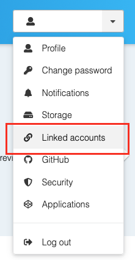{width=20% fig-alt="The menu under your name on Zenodo, with Linked accounts in it."}

3. Click **Connect** next to **GitHub**.

   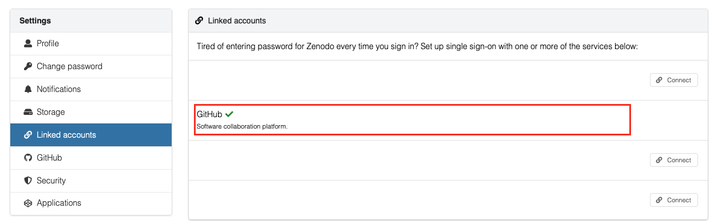{width=80% fig-alt="The Linked accounts page on Zenodo, with a Connect button next to GitHub."}
:::

1. Go to [zenodo.org](https://zenodo.org) and click **Log in**.
2. Choose **Log in with GitHub**, and click **Authorize** when GitHub
   asks whether Zenodo may access your account.

   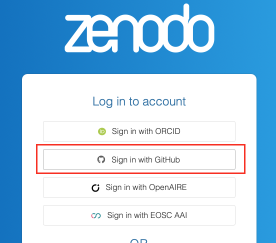{width=30% fig-alt="The Zenodo login page, with the button Log in with GitHub."}

3. The first time, Zenodo asks for your name and email address. If it
   sends you an email, click the link in it to confirm your address.


**2. Turn on Zenodo for your repository**

Next, you connect your GitHub training repository to Zenodo. From then on,
Zenodo archives every new release of your repository, and gives it a
DOI.

::: {.callout-important collapse="true" title="Is your repository in an organisation?"}
If your repository doesn't belong to your personal GitHub account, but
to an organisation, such as
[SciLifeLab-Training](https://github.com/SciLifeLab-Training) or
[NBISweden](https://github.com/NBISweden), the organisation first has
to give Zenodo access to its repositories.

You can see whether your repository belongs to an organisation in its
URL: in `github.com/SciLifeLab-Training/introduction-to-r`, the
organisation is `SciLifeLab-Training`. If the first part is your own
GitHub username, the repository is yours, and you can skip this box.

**What you do:**

1. To check whether Zenodo has access to your organisation's
   repositories, log in to GitHub. Click your profile picture at the
   top right, then **Settings**.

   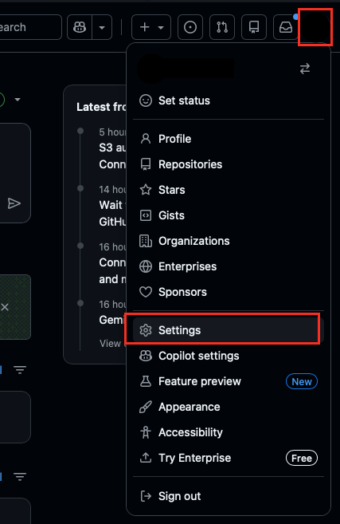{width=40% fig-alt="The menu under your profile picture on GitHub, with Settings in it."}

2. In the sidebar on the left, under **Integrations**, click
   **Applications**, and then the tab **Authorized OAuth Apps**.

   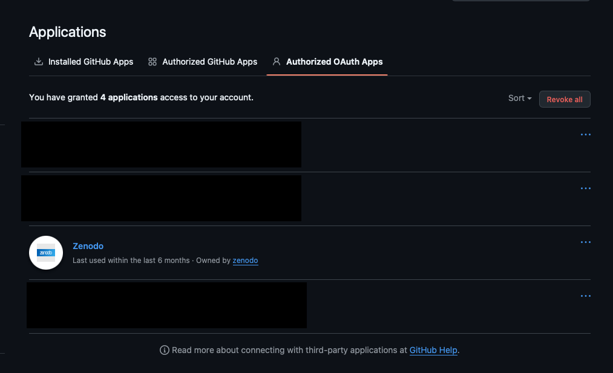{width=70% fig-alt="The Applications page in the GitHub settings, with the tab Authorized OAuth Apps and Zenodo in the list."}

3. Click **Zenodo**. Under **Organization access**, find your
   organisation:
   - A green check means Zenodo already has access. You're done.
   - **Request** means it doesn't have access yet. Click it, so that
     the owners of the organisation get an access request.

   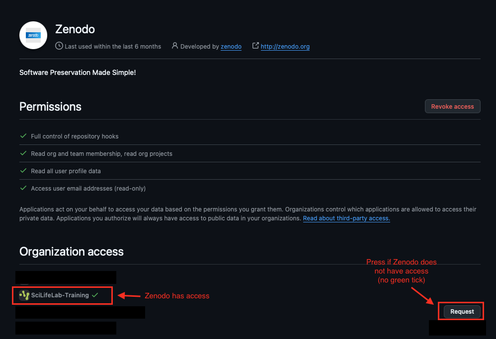{width=90% fig-alt="The Zenodo page in the GitHub settings. Under Organization access, each organisation has either a green check or a Request button."}

**What the owner of your organisation does:**

The GitHub organisation owner(s) has to approve the request. To find out
who the owners are, go to the organisation's page on GitHub, click
**People**, and look for **Owner** next to the names. Ask one of them
to:

1. Go to the organisation's **Settings → Third-party access → OAuth
   app policy**.
2. Find **Zenodo** in the list of requests, and click **Review**, then
   **Grant access**.

You only need to do this once per organisation. After that, every
repository in the organisation can be connected to Zenodo.
:::

1. On Zenodo, click your name at the top right, then **GitHub**.

   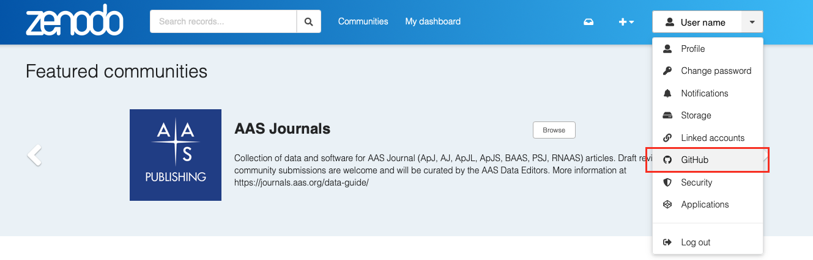{width=80% fig-alt="The menu under your name on Zenodo, with GitHub in it."}

2. Click **Sync now**, and then **reload the page**. Zenodo only shows
   the repositories it knew about the last time it synced, and the list
   doesn't update by itself.

   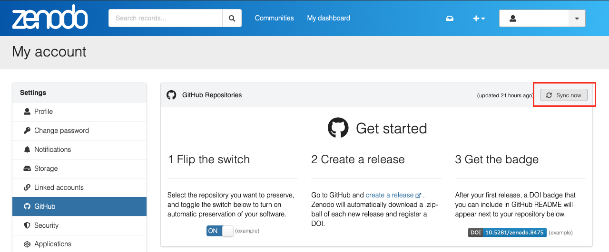{width=80% fig-alt="The GitHub page on Zenodo, with the Sync now button at the top right."}

3. Find your repository in the list, and click its switch to turn it
   **On**.

   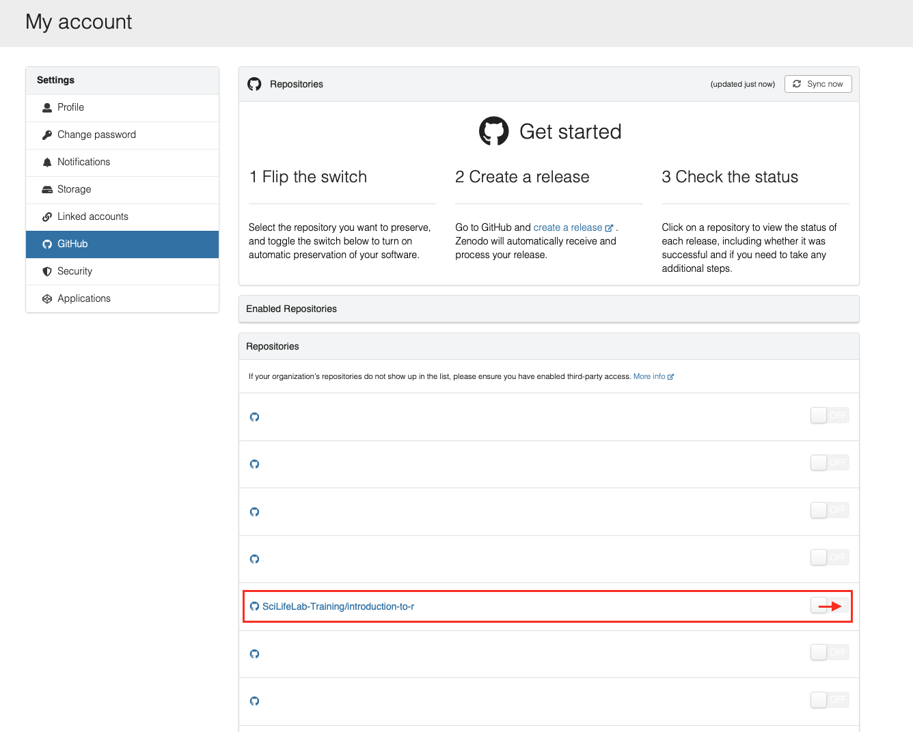{width=80% fig-alt="The list of repositories on Zenodo, with the switch next to the repository turned on."}

4. A green banner appears, saying **Repository synced successfully.
   Please reload the page.** Reload the page. Your repository is now
   listed under **Enabled Repositories**.

   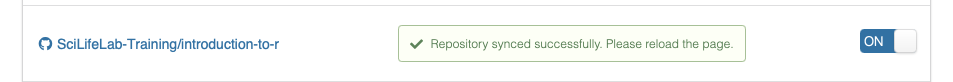{fig-alt="The green banner on Zenodo saying that the repository was synced successfully."}


::: {.callout-tip collapse="true" title="Your repository still doesn't show up, or the switch doesn't turn on?"}
- **Is the repository public?** Zenodo can't archive private
  repositories. You can check this on GitHub, under **Settings →
  General**, at the very bottom.
- **Do you have admin rights on the repository?** Zenodo needs admin
  rights to connect to it. If the switch doesn't turn on, ask an owner
  of the organisation to give you the admin role on the repository.
- **Did you sync and reload?** Click **Sync now** again, wait a moment,
  and reload the page.
:::

**3. Create a release on GitHub**

A release is a snapshot of your GitHub training repository at a certain moment, with a
name and a version number. As soon as you publish a release, Zenodo
archives that snapshot and gives it a DOI.

Before you start, make sure that:

- Your data files are complete, especially the authors and their
  ORCIDs. Zenodo copies this information when you publish, and you
  can't change it automatically afterwards.
- Your latest changes are pushed to the branch of your training
  instance, and the website has finished building. On GitHub, you can
  see this under **Actions**: the last run has a green check.


1. Go to your repository on GitHub. In the sidebar on the right, under
   **Releases**, click **Create a new release**.

   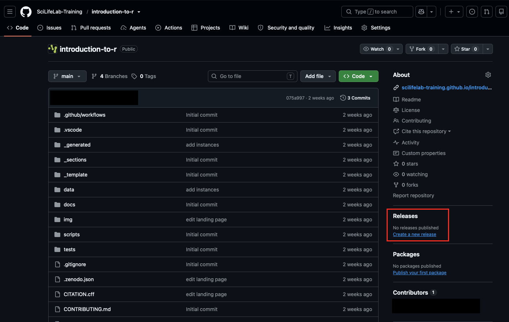{fig-alt="The sidebar of a GitHub repository, with the link Create a new release under Releases."}

2. Choose the branch of your training instance. Click **Target**, and
   choose the branch, for example **release-2706**. Zenodo archives
   the repository as it is on this branch.

   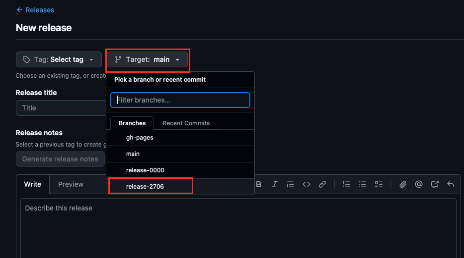{width=80% fig-alt="The Target menu on the new release page on GitHub, with the branch release-2705 selected."}

3. Give the release a tag. Click **Choose a tag**, type a new tag, for
   example `v2706.1`, and click **Create new tag**. The tag is the
   version number of your release: Zenodo shows it as the version of
   your training.

    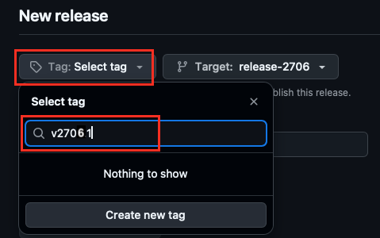{width=45% fig-alt="The Choose a tag menu on the new release page on GitHub, with the new tag v2706.1 typed in and the option Create new tag."}

   ::: {.callout-tip collapse="true" title="Which tag should I use?"}
   Use a tag that shows which training instance the release belongs
   to, and which version of that instance it is. For example, `v2706.1`
   is the first release of the training instance of June 2027. If you
   later fix something in the materials of that instance, the next
   release is `v2706.2`. The first release of the next training
   instance could then be `v2711.1`.

   A tag can't have the same name as a branch, so don't use
   `release-2706` as a tag.
   :::
4. Fill in a **Release title**, for example
   `Introduction to R, June 2027`. In the description, you can write a
   few sentences about this release, such as what's in it, or what's
   new.

   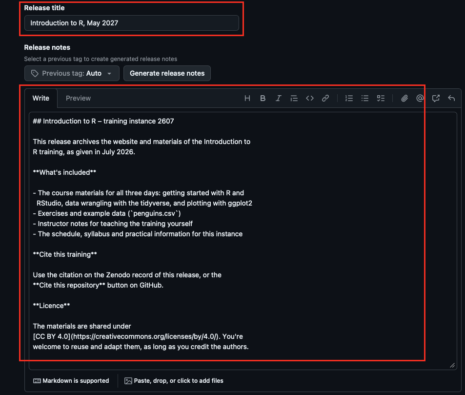{width=85% fig-alt="The new release page on GitHub, with the release title Introduction to R, June 2027 and a description of the release filled in."}

5. Click **Publish release**. GitHub now opens the page of your new
   release. It shows your release notes and, under **Assets**, a zip
   file of your repository as it is on the branch of your training
   instance.

   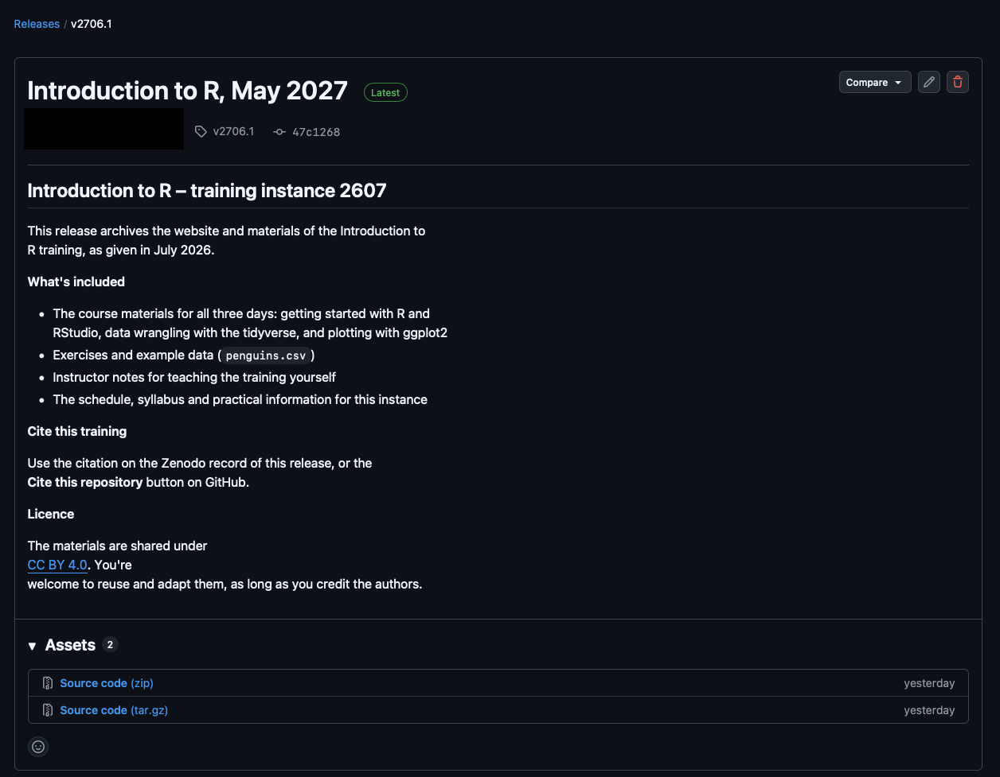{width=90% fig-alt="The page of the published release on GitHub, with the release notes and, under Assets, the source code as a zip file."}

    On the main page of your repository, the release is now shown under **Releases**, in the sidebar on the right.

    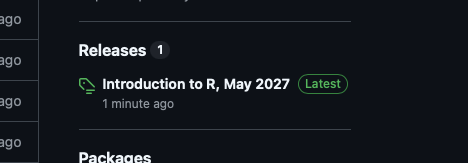{width=50% fig-alt="The sidebar on the main page of the repository on GitHub. Under Releases, the new release is shown and marked as Latest."}

**4. Check your release on Zenodo**

As soon as you publish a release on GitHub, Zenodo gets a message about
it. Within a few minutes, Zenodo archives the release, creates a record
for it, and gives it a DOI. You don't need to do anything for this, but
it's good to check that everything went well, and that the information
on Zenodo is right.

1. On Zenodo, click your name at the top right, then **GitHub**. Your
   repository, listed under **Enabled Repositories**, now has a blue
   **DOI** badge next to it. If you don't see the badge yet, wait a few
   minutes and reload the page.

   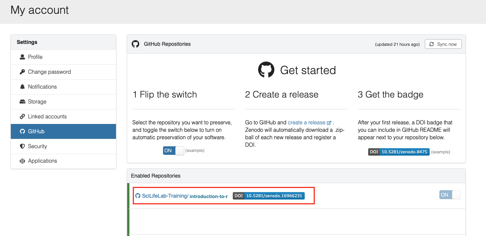{fig-alt="The list of enabled repositories on Zenodo. Next to each repository name is a blue badge with its DOI."}

2. Click the name of your repository. You see a list of all its
   releases, with the status of each one. **Published** means that
   Zenodo archived the release, and that it has a DOI.

   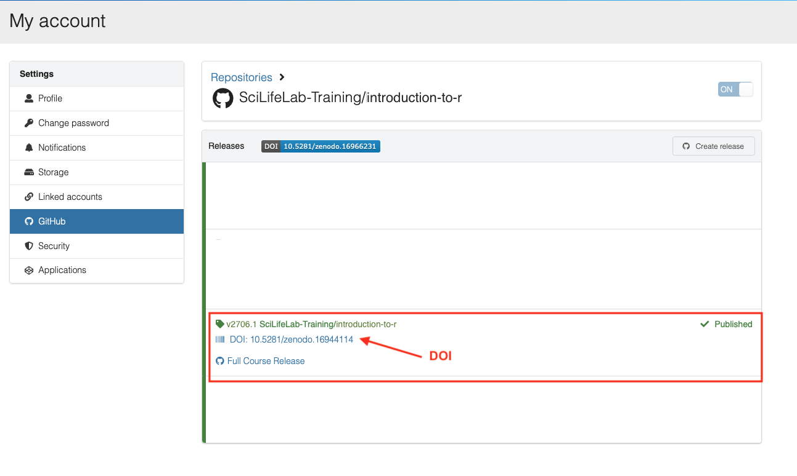{fig-alt="The page of one repository on Zenodo, with a list of its releases. Each release has the status Published."}

3. Click the DOI of the release. This opens the full Zenodo record of
   your release. On the left, you see the title, authors and
   description of your training, and all the files in your repository.
   On the right, you see how many people have viewed and downloaded
   your record, the earlier versions, the licence and how to cite it.
   Check that the title, authors, ORCIDs, licence and keywords are
   right.

   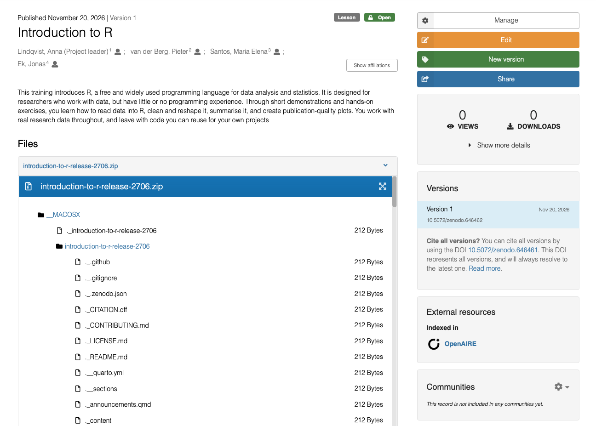{fig-alt="The full record of a training on Zenodo. On the left are the title, authors, description and files. On the right are the numbers of views and downloads, the versions, and the DOI."}

::: {.callout-tip collapse="true" title="The status is not Published, or something is wrong in the record?"}
- **The release doesn't show up at all.** Zenodo only archives releases
  that you publish *after* turning Zenodo on for your repository. Check
  that your repository is under **Enabled Repositories**, and publish a
  new release.
- **The status is Failed, or shows an error.** Click the release to
  see the error message. Often, a field in `.zenodo.json` is missing
  or not filled in correctly. Fix it in your data files, push your
  changes, wait until the website has finished building, and publish a
  new release.
- **Something in the record is wrong**, such as a missing ORCID or a
  typo in a name. On the record, click **Edit**, correct the
  information, and click **Publish**. This changes the information
  only: the archived files and the DOI stay the same. Also correct it
  in your data files, so the next release is right too.
:::

**5. Add the DOIs to your data files**

Finally, you add the DOIs that Zenodo has given your training to your data files. The template then puts
them in the citation, the README and on your website, so that everyone
who wants to cite your training uses the DOI.

1. On the Zenodo record of your release, find the two DOIs of your
   training:

   - **The DOI of this version** is in the **Details** box on the
     right. It belongs to this one release only.
   - **The DOI of all versions** is in the **Versions** box on the
     right, under **Cite all versions?**. It stays the same for every
     release of your repository, and always leads to the latest
     version.

   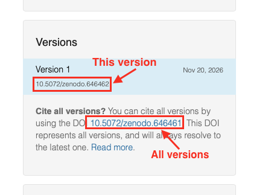{width=50% fig-alt="The Versions box on a Zenodo record. Below the list of versions, it says that you can cite all versions with one DOI, and shows that DOI."}

2. On the branch of your training instance, open `data/course.yml`.
   Under `reuse`, fill in the two DOIs. Write them as Zenodo shows
   them, starting with `10.5281`:

   ```yaml
   reuse:
     doi: "10.5281/zenodo.14643653"          # the DOI of all versions
     version_doi: "10.5281/zenodo.16966231"  # the DOI of this version
   ```

   Leave the other fields under `reuse` as they are.

3. Do the same on **main**, so that the landing page also shows the
   DOI.
4. Commit and push your changes on both branches, as described in
   [Regular workflow](workflow.qmd). When the website has finished
   building, the DOI shows up in `CITATION.cff`, in the README and on
   your website.

::: {.callout-note collapse="true" title="Why isn't the DOI in the release on Zenodo?"}
Zenodo only creates the DOI after you publish the release. So the
release that Zenodo archived can't contain its own DOI yet. That's
normal, and nothing to worry about: the Zenodo record itself shows the
DOI, and your repository and website show it from now on.
:::

::: {.done}
**Done when:** on the main page of your repository on GitHub, **Cite
this repository** shows the DOI of your training, and the DOI is on
your website.
:::