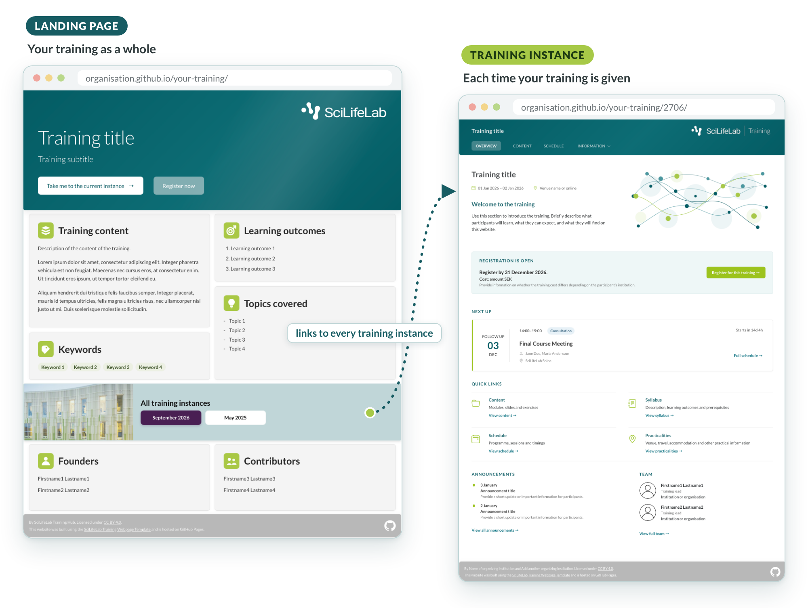

Welcome to the **SciLifeLab Training Webpage Template User Guide**!

This guide shows you, step by step, how to make an open-source,
FAIR-*by-design* website for your training with the
**[SciLifeLab Training Webpage Template](https://scilifelab-training.github.io/scilifelab-training-template/)**,
made by the [SciLifeLab Training Hub](https://www.scilifelab.se/training/).

During the training, the website gives participants one place to find
the schedule, the materials and the practical information. After the
training, it lets others find, cite and reuse what you made. The
template works for most kinds of training: online or in person,
recurring or one-off, self-paced or in cohorts.

This is what a training website made with the template looks like:

{fig-alt="The example training website made with the template. On the left is the landing page, which describes the training as a whole. An arrow goes from its list of all training instances to the overview page of one training instance on the right."}

Want to look around more? Visit the
[example training website](https://scilifelab-training.github.io/scilifelab-training-template).

### What you get {.unnumbered}

:::: {.grid .intro-cards}

::: {.g-col-12 .g-col-md-4 .intro-card}
**Ready to use**

A complete, SciLifeLab-branded website: overview, schedule, syllabus,
team, information pages and room for your materials.
:::

::: {.g-col-12 .g-col-md-4 .intro-card}
**No programming**

You fill in your information in text files, and write your materials in
Markdown. The website is built and published for you.
:::

::: {.g-col-12 .g-col-md-4 .intro-card}
**FAIR-*by-design***

Your training gets a citation, licence and information that
registries can read, generated from the same text files.
:::

::::

### Get started {.unnumbered}

All you need is a computer and a free [GitHub](https://github.com)
account. You don't need any experience with Git, Python or Quarto: the
guide explains every step.

The chapters follow the order in which you build your website: setting
up your copy, the landing page, your training instances and materials,
and finally making your training FAIR. Work through them in order, or go straight to the chapter you need.

[Start here →](setup.qmd){.btn .btn-primary}

### Need help? {.unnumbered}

Contact the SciLifeLab Training Hub at <training@scilifelab.se>.