Your training instance website now has its overview page, syllabus,
team and other information pages, all built from data files. What's
still missing are the training materials: the pages participants work
through. They are the heart of your training instance website.

**The training materials work differently from the rest of the
website.** They aren't built from data files: you write them yourself,
as pages in **Markdown**, a simple way of formatting text. Each page with training material is a `.qmd` file in the `content` folder. 

Next to your training materials, you can also write **instructor notes**, in
the `instructors` folder. Where the training materials tell participants
*what* to learn, the instructor notes tell instructors *how to teach
it*. These are written in Markdown too.

In this chapter, you will learn how to:

- [Organise your training sections and pages](#organise-your-training-sections-and-pages): divide your training materials into sections, such as modules or days, and add them to the navigation of your website.
- [Add content to your pages](#add-content-to-your-pages): Write your training materials in Markdown, with text, images, presentations and links.
- [Write instructor notes](#write-instructor-notes): describe how to
teach your training, for everyone who teaches or reuses it.


### Before you start {.unnumbered}

Everything in this chapter happens on the **branch of your training instance** (for example
**release-2706**). 

Work as described in [Regular workflow](workflow.qmd). 

The [cheat sheet](#cheat-sheet) at the end of this chapter sums up which
file to open, and what to change, for each part of your training instance
website.

## Organise your training sections and pages 

Before you write your training materials, you first have to decide how
to organise them. Most of your training materials are in the `content`
folder of your training instance branch: the content pages of your
website are built from there. In this section, you will learn how the
`content` folder is organised, how to divide your materials into
sections, how to add and remove sections, and how to make them appear on
your training instance website.

### Where your training material lives {.unnumbered}
You write your training materials in the `content` folder of your training instance branch. The content folder contains:

- `index.qmd`: the **Content introduction page**, which introduces your materials
  and gives an overview of the sections. This file must keep
  the name `index.qmd`: the **Content** link in the navigation bar leads
  to it.
- `_metadata.yml`: the settings for all pages in the `content` folder,
  such as the table of contents on the right. You don't need to change
  this file.
- One folder for each **section**, with one `.qmd` file for each page in
  that section.

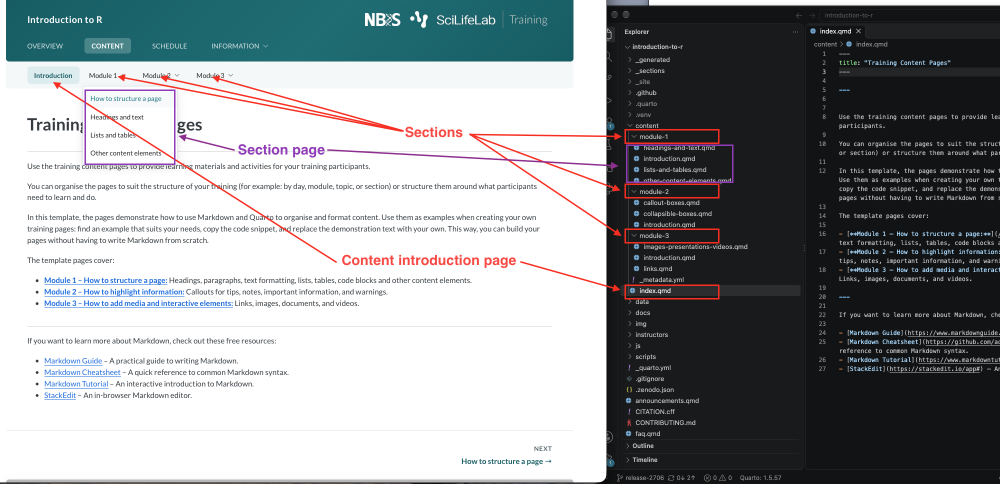{width=100% fig-alt="Screenshot: the content folder in VS Code next to a content page in the browser, with each section folder linked to its menu in the navigation bar of the content pages."}

As you can see, your training materials are divided into **content
sections**. The template's examples use modules: `module-1`, `module-2`
and `module-3`. But sections don't have to be modules: you decide
yourself how to organise your training materials. For example, a section
can be a module, a day, a topic or a week. Choose what fits your
training,

On the website, each section gets its own dropdown menu in the
navigation bar of the content pages, listing the pages in that section:
see the purple boxes and text in the image above.

For example, Introduction to R is a training of three days, with a few
topics each day. Its `content` folder could look like this, with one
section per day:

```text
content/
├── _metadata.yml          Settings for the content pages: leave as it is
├── index.qmd              The Content introduction page: keep this name
├── day-1/                 A section, with its pages:
│   ├── introduction.qmd
│   ├── rstudio-basics.qmd
│   └── reading-data.qmd
├── day-2/
│   ├── tidy-data.qmd
│   └── filter-and-reshape.qmd
└── day-3/
    ├── introduction-to-ggplot2.qmd
    └── customise-your-plots.qmd
```

### Add a content section {.unnumbered}
When you've decided how to organise your materials, you can start adding
your content sections.

::: {.callout-important}
## Adding a section always takes two steps

1. Create its folder in the `content` folder, with its pages.
2. List the folder in `data/website.yml`.

A folder that isn't listed in `data/website.yml` doesn't appear on the
website.
:::

**Step 1: Create the folder and its pages**

1. In the Explorer panel in VS Code, right-click the `content` folder,
   and choose **New Folder...**.

   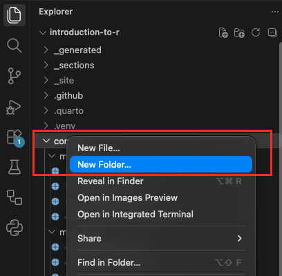{width=30% fig-alt="Screenshot: the menu that opens when you right-click the content folder in VS Code, with New Folder selected."}

2. Type the name of the folder, and press **Enter**. Use only lowercase
   letters, numbers and hyphens: no capital letters, and no spaces. For
   example: `day-1`, `data-wrangling` or `module-4`.

   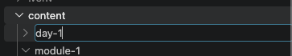{width=40% fig-alt="Screenshot: the name of a new section folder typed in the Explorer panel, inside the content folder."}


3. Right-click your new folder, and choose **New File...**.

   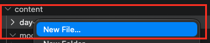{width=40% fig-alt="Screenshot: the menu that opens when you right-click the new section folder, with New File selected."}

4. Type the name of the page, ending in `.qmd`, and press **Enter**. For
   example: `introduction.qmd`. Use lowercase letters, numbers and
   hyphens here too.
5. The new file opens. Type this header at the very top, with your own
   title, and save the file:

   ```markdown
   ---
   title: "Introduction"
   order: 1
   ---
   ```

   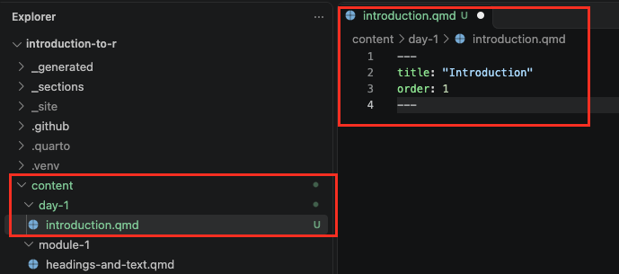{width=65% fig-alt="Screenshot: a new page file open in VS Code, with the header holding its title and order number."}

6. Add more pages to the folder in the same way, with `order: 2`,
   `order: 3`, and so on.

The pages appear in the section's menu in the navigation bar, in the
order of their `order` numbers. To change the order, change the
numbers.

For example, these are the section folders and pages of Introduction to
R:

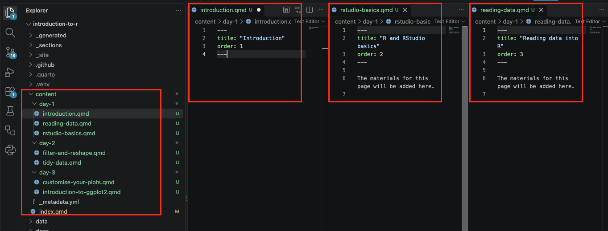{width=100% fig-alt="Screenshot: the content folder of Introduction to R in the Explorer panel, with the folders day-1, day-2 and day-3, each with its pages."}

::: {.callout-tip}
Want to look up how to write something in Markdown? Keep the template's
example pages for now: don't delete their folders, `module-1` to
`module-3`. In the next step, you'll see how to keep them off your
website, while they stay in your repository for you to look at.
:::


**Step 2: List the section in website.yml**

Your new sections and pages are now in your repository, but they don't
appear on your website yet. To make them appear, list each section in
`data/website.yml`:

1. Open `data/website.yml`, and scroll to the `content` part at the
   bottom. Each section has an entry of three lines, like this one from
   the template:

   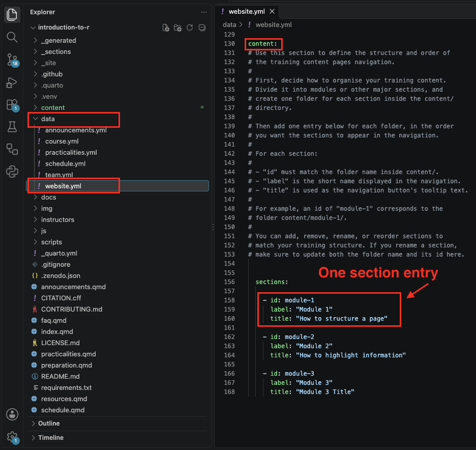{width=75% fig-alt="Screenshot: the content part at the bottom of data/website.yml, with an entry of three lines for each of the template's sections."}

2. Copy a whole entry, from `- id:` to `title:`, and paste it below the
   last entry. **Keep the spaces at the start of each line exactly as in
   the other entries.**

   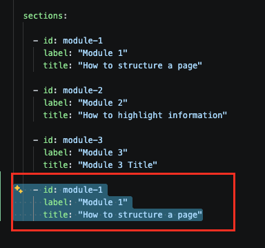{width=35% fig-alt="Screenshot: a copied section entry pasted below the last entry in data/website.yml."}

3. Change the three values to your new section
   - `id`: the name of your folder, **exactly as you typed it in step 1**,
     for example `day-1` for introduction to r.
   - `label`: the short name in the navigation bar, for example`"Day 1"`.
   - `title`: the text visitors see when they hover over the section in
     the navigation bar, for example `"Getting started"`.

4. **The first time only:** delete the entries of the template's
   sections, `module-1` to `module-3`, each from `- id:` to `title:`.
   This only removes them from your website. Their folders stay in the
   `content` folder, so you can still look at the example pages.

   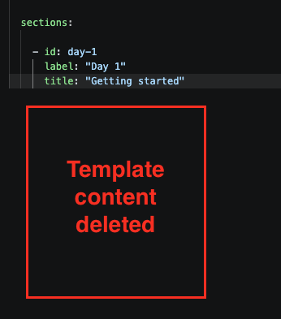{width=35% fig-alt="Screenshot: the content part of data/website.yml with the template's module entries deleted, and only your own section left."}

5. Save the file, and check the preview: your section appears in the
   navigation bar of the content pages.

   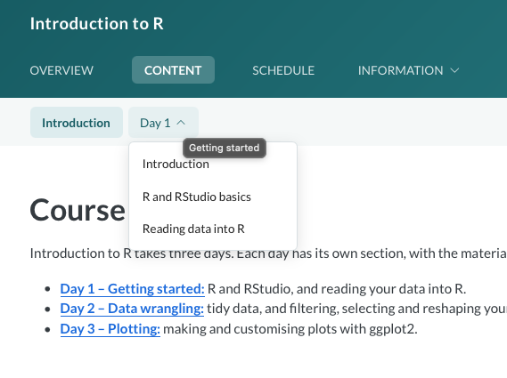{width=50% fig-alt="Screenshot: the navigation bar of the content pages in the preview, with the new section and its menu of pages."}

::: {.callout-important}
The `id` must be exactly the same as the name of the folder, letter for
letter. If you rename a folder later, also change its `id` in `data/website.yml`, or the
preview stops with an error that names the missing folder.
:::

For example, this is the `content` part of `data/website.yml` for
Introduction to R:

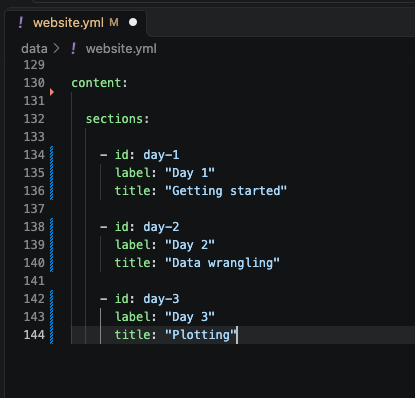{width=40% fig-alt="Screenshot: the content part of data/website.yml for Introduction to R, with entries for day-1, day-2 and day-3."}

And this is how the sections appear on its website:

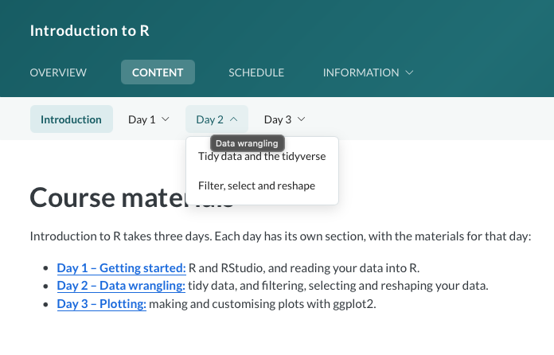{width=60% fig-alt="Screenshot: the content pages of Introduction to R, with Day 1, Day 2 and Day 3 in the navigation bar, and the menu of one day opened."}


### Remove a content section {.unnumbered}

You can remove a section in two ways:

- **Only from the website:** the section disappears from the navigation
  bar, but its folder and pages stay in your repository. Useful if you
  might need the section again later, or want to keep it as an example.
- **Completely:** the section disappears from the website, and its folder
  and pages are deleted from your repository.

**To remove a section from the website only:** in `data/website.yml`,
delete the section's whole entry, from `- id:` to `title:`, and save the
file.

**To remove a section completely,** do these two steps, in this order:

1. In `data/website.yml`, delete the section's whole entry. Save the file.
2. In the Explorer panel, right-click the section's folder in the
   `content` folder, and choose **Delete**. This deletes all its pages
   too.

::: {.callout-important}
Always delete the entry in `data/website.yml` first. If you delete the
folder first, `data/website.yml` still lists a folder that no longer
exists, and the preview stops with an error.
:::

## Add content to your pages

With your sections and pages set up, it's time to fill the content pages
with your training materials. In this section, you work through the
parts of a content page: the content part, where you write your
materials, and the **On this page** list and **Previous** and **Next**
links, which are made automatically. The image below shows the parts of
a content page:

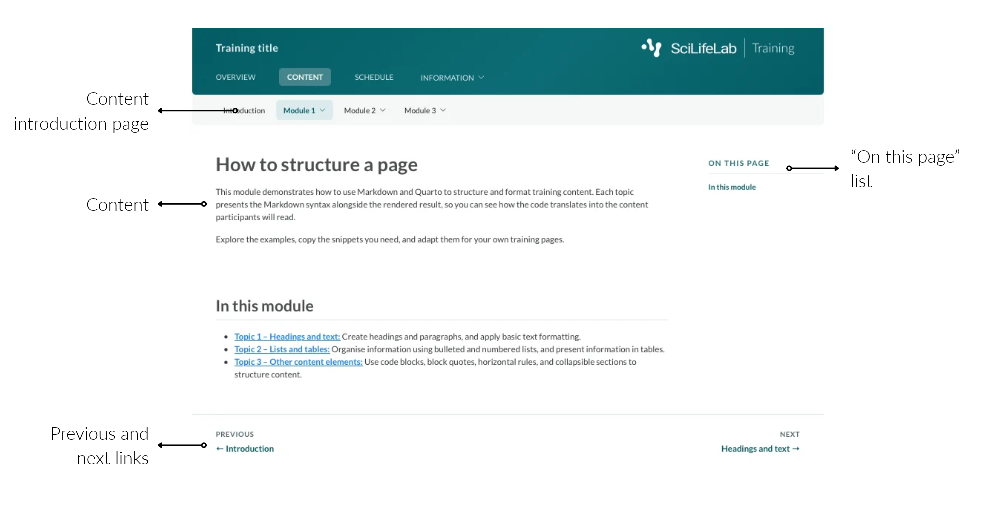{width=100% fig-alt="Annotated screenshot of a content page: the navigation bar with the section menus, the page title, the text of the page, the On this page list on the right, and the Previous and Next links at the bottom."}


### The content part {.unnumbered}

In the content part, you add the text, images, presentations, exercises
and everything else of your training. You write it directly in the
page's `.qmd` file, below the header, in **Markdown**: a simple way of
formatting text.

For help with Markdown, the template comes with its own guide: the
[example content pages](https://scilifelab-training.github.io/scilifelab-training-template/0000/content/index.html).
They show how to write headings, lists, tables, callout boxes, images,
videos and links, each with the Markdown ready to copy and paste into
your own pages.

**Tips for adding images, PDFs and other files**

To use images, PDFs, slides or data files on your pages, first put the
files in the **`docs` folder** of your training instance branch:

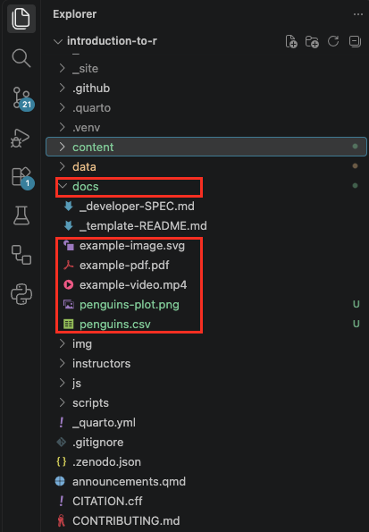{width=40% fig-alt="Screenshot: the docs folder in the VS Code Explorer, with images, a PDF and a data file used on the content pages."}

Then link to them from your pages: the example page
[Images, presentations and videos](https://scilifelab-training.github.io/scilifelab-training-template/0000/content/module-3/images-presentations-videos.html)
shows how.

- Only the files you link to from a page are published on your website.
  Files in `docs` that no page links to stay in your repository only.
- Keep files small. GitHub warns about files over 50 MB, and large files
  make your repository slow to work with. For videos, an embedded online
  video, for example on YouTube, is usually the better choice.
- Give every image a short description, for visitors who can't see it.
  The example page shows how.

**Tips for adding presentations**

To share presentations on your training instance website, you have
several options:

| Option | Good to know |
|---|---|
| **Upload files to the repository**, for example PDF slides | Put the file in the `docs` folder, and link to it from your page: see [Linking to a file or resource within your training repository](https://scilifelab-training.github.io/scilifelab-training-template/0000/content/module-3/links.html). The file is kept in your repository, so it stays available as long as your repository does |
| **Link to an online file**, such as Google Slides | See [Linking to resources hosted elsewhere](https://scilifelab-training.github.io/scilifelab-training-template/0000/content/module-3/links.html). Easy to make and update together, but the link can stop working, or need access rights that others don't have |
| **Make presentations in Quarto** | Part of your training website, and archived with it. More technical, and takes some getting used to |

: {tbl-colwidths="[35,65]"}

**Example: a page of Introduction to R**

This page of Introduction to R has headings, an image, a link to a file
in the `docs` folder, an exercise with a hidden solution, and some R
code:

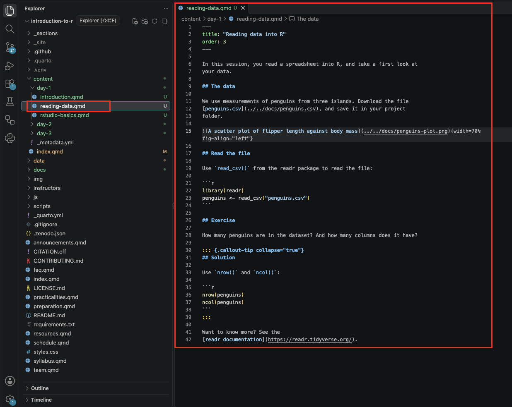{width=100% fig-alt="Screenshot: a page of Introduction to R open in VS Code, with its header, headings, an image, a link, an exercise with a collapsible solution, and a code block."}

And this is how it looks on the website:

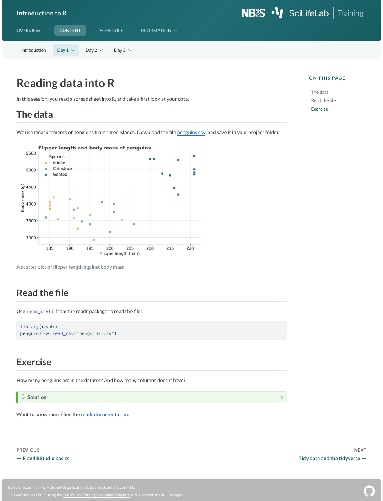{width=90% fig-alt="Screenshot: the same page in the browser, with the image, the link, the exercise with its solution hidden, and the code block with a copy button."}

::: {.callout-note}
Code blocks are shown on the page, with a button to copy them, but they
are **not run** when the website is built. Participants copy the code,
and run it themselves.
:::

**Now write your own pages.**   
With the example content pages and the tips above, start with the Content introduction page,
`content/index.qmd`: introduce your training materials, and give an
overview of your sections, with a link to the first page of each.
**Keep the file name `index.qmd`.** Then work through the rest of your sections and
pages.

### The "On this page" list {.unnumbered}

The **On this page** list on the right of each content page is made
automatically from the headings of the page:

- Headings starting with `##` appear in the list. Use them for the main
  parts of a page.
- Headings starting with `###` don't appear in the list. Use them for
  smaller parts within a main part.
- Don't use a heading starting with a single `#`: the page title, from
  the header at the top of the file, is already the main heading.

### Previous and next links {.unnumbered}

At the bottom of each content page, **Previous** and **Next** links lead
through all your materials in one sequence: first the Content
introduction page, then the pages of each section, in the order of the
sections in `data/website.yml` and the `order` numbers of the pages.
The last page of a section links to the first page of the next one.

The links are made automatically, and show the `title` of the page they
lead to. To change where they lead, change the order of the sections or
pages, as described in
[Organise your training sections and pages](#organise-your-training-sections-and-pages).


## Write instructor notes {#write-instructor-notes}

You have now added your training materials, which show participants
*what* to learn. But your repository doesn't yet say anything about
*how* to teach those materials. That information is useful for everyone
who teaches your training, and you can add it as **instructor notes**,
in a separate folder: `instructors`.

In this section, you will learn why
instructor notes are worth writing, what's in the `instructors` folder,
and how to write your own notes.

### Why write instructor notes? {.unnumbered}

Instructor notes show instructors *how* to teach your training: for
example, how long each part takes, what to prepare, and where
participants usually get stuck. They are useful in different situations,
for example:

- **Several people teach the training,** for example taking turns, or
  each teaching a different section.
- **New instructors join,** or the training is taught again a year
  later. 
- **Others want to reuse your training.** With instructor notes, they
  can teach it themselves without having to ask you. That makes your
  training much easier to reuse, which is one of the aims of FAIR
  training materials.

### What's in the instructors folder {.unnumbered}

The `instructors` folder mirrors your `content` folder: one file for
each section of your materials, plus a `README.md` for the training as a
whole. All files are written in plain Markdown.

For example, for Introduction to R:

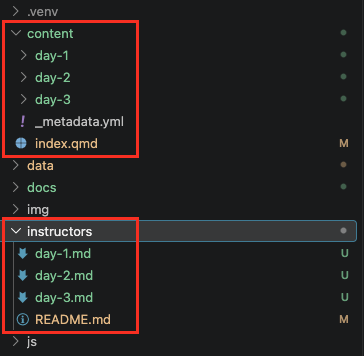{width=50% fig-alt="Screenshot: the content and instructors folders of Introduction to R in the VS Code Explorer, with the folders day-1 to day-3 in content, and README.md and day-1.md to day-3.md in instructors."}

| File | What it covers |
|---|---|
| `README.md` | The training as a whole: who can teach it, the timing of each section, how to prepare, the technical setup, and what to do during and after the training |
| One file per section, named after its folder, for example `day-1.md`, `module-1.md` or `data-wrangling.md` | That section: its key points, teaching flow, materials, exercises, common problems, and what to skip if you're short of time |

: {tbl-colwidths="[35,65]"}

### Fill in the instructor notes {.unnumbered}

You are now ready to fill in the instuctor notes. For this, you don't have to start from scratch. the template's `instructors`
folder comes with a skeleton to fill in, a `README.md` for the training
as a whole, and `module-1.md` and `module-2.md` for its example
sections. Use these files as a starting point: rename them, copy them,
and fill them in. You're also welcome to change the headings, or to
write your notes in your own way: the skeleton is a suggestion, not a
rule.

::: {.callout-important}
## Not on the website, but not private either

Anyone can read your instructor notes on GitHub, and they are archived
on Zenodo together with your materials.

Never write anything that must stay secret, such as passwords, access
codes, or answers to exams and graded assignments. Once pushed, deleting
it doesn't remove it: it stays in the history of your repository.
:::

1. Open `instructors/README.md`, and replace the example text with your
   own. 
2. Rename `module-1.md` after your first section: right-click it in the
   Explorer panel, choose **Rename...**, type the new name, for example
   `day-1.md`, and press **Enter**. Then fill in the file.
3. For each other section, add an instructor file with the same name as
   the section's folder. The easiest way is to copy a file:
   - In the Explorer panel, right-click an existing section file, for
     example `day-1.md`, and choose **Copy**.
   - Right-click the `instructors` folder, and choose **Paste**.
   - Right-click the copy, choose **Rename...**, type the new name, for
     example `day-2.md`, and press **Enter**.
4. Delete the template files you don't use, such as `module-2.md`.
5. In the timing table in `instructors/README.md`, add a row for each
   section, with a link to its file.
6. Save your files, and commit and push them. Instructor notes don't
   appear in the preview: to see how they look, open them on GitHub.

For example, this is `instructors/README.md` for Introduction to R:

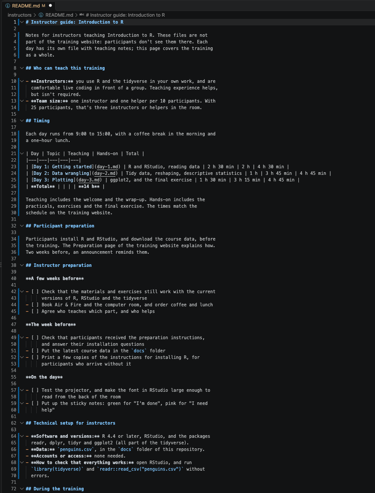{fig-alt="Screenshot: instructors/README.md of Introduction to R, with who can teach the training, a timing table for the three days, and the instructor preparation checklists."}

And these are the instructor notes for its first day, `day-1.md`:

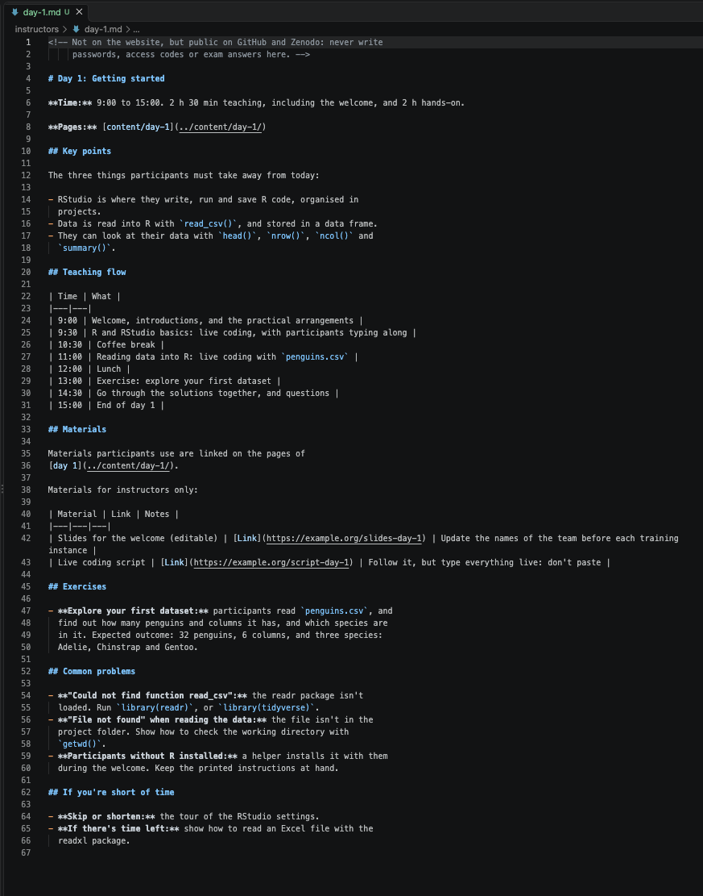{fig-alt="Screenshot: instructors/day-1.md of Introduction to R, with the key points of the day, the teaching flow from 9:00 to 15:00, the materials, the exercise, and common problems."}

## Cheat sheet

All on the branch of your training instance.

| To... | Where | What to do |
|---|---|---|
| Add a section | `content/` and `data/website.yml` | Create a folder with its pages, and add an entry under `content` → `sections`, with the folder's name as `id` |
| Reorder sections | `data/website.yml` | Move whole entries up or down under `content` → `sections` |
| Remove a section | `data/website.yml`, then `content/` | First delete its entry, then its folder |
| Add a page | The section's folder | Add a `.qmd` file with `title` and `order` in the header at the top |
| Reorder pages | The pages' `.qmd` files | Change the `order` numbers |
| Add a part to "On this page" | The page's `.qmd` file | Start its heading with `##` |
| Add images, PDFs and other files | `docs/` | Put the file in the folder, and link to it from the page |
| Write instructor notes | `instructors/` | Fill in `README.md` and the file for each section |
| Add or remove a section's instructor notes | `instructors/` | Add or delete the file with the section's folder name, and its row in the timing table in `README.md` |

: {tbl-colwidths="[25,30,45]"}

