Now that you have created your training instance, it's time to fill it
with the information about your training. As on the
[landing page](landing-page.qmd), you do this in data files. For training instances, some of these files are required, and others are optional. Which optional files you include is up to you and depends on the type of training you give.

In this chapter, you will learn how to:

- [Switch off template mode](#switch-off-template-mode): replace the
  README and remove the template banner.
- [Fill in the required data files](#required-information): the
  overview page, the training and the team.
- [Fill in the optional data files](#optional-pages): the schedule,
  announcements, practicalities, preparation, FAQ and resources.

How to add your training materials and instructor notes to your training instance follows in the next chapter, [Instance pages - Content](instance-pages-content.qmd).

### Before you start {.unnumbered}

Everything in this chapter happens on the **branch of your training instance** (for example
**release-2706**), and almost all of it in the data files in the `data` folder. 

Not sure how a data file works? See [Data files](repository-structure.qmd#data-files).

Work as described in [Regular workflow](workflow.qmd). 

The [cheat sheet](#cheat-sheet) at the end of this chapter sums up which
file to open, and what to change, for each part of the training instance
website.

## Switch off template mode {#switch-off-template-mode}

Just like the [landing page](landing-page.qmd#switch-off-template-mode),
your training instance branch still presents itself as the template, in
two places: the README and the template banner. Replace the README, and
then switch off template mode, so your training instance presents your
own training.

::: {.callout-note}
Do this once, on the branch of your **first** training instance: the one
you created from **release-0000** (see
[Create your first new training instance](training-instances.qmd#create-your-first-new-training-instance)).
Later training instances start from that branch, so these changes come
along: template mode is already switched off there.
:::

### Replace the README {.unnumbered}

1. In the Explorer panel, open `docs/_template-README.md`, select all
   text, and copy it.

   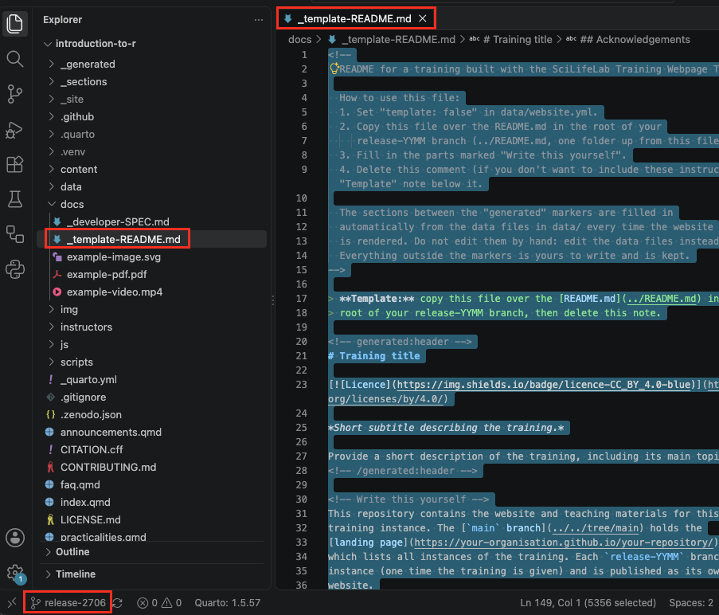{width=85% fig-alt="Screenshot: template-README.md file in docs/ folder"}

2. Open `README.md` in the main folder of your instance branch, select all
   text, and paste, so the copied text replaces it.
3. Delete the note at the top of the file, between `<!--` and
   `-->`, and the line starting with `> **Template:**`.

   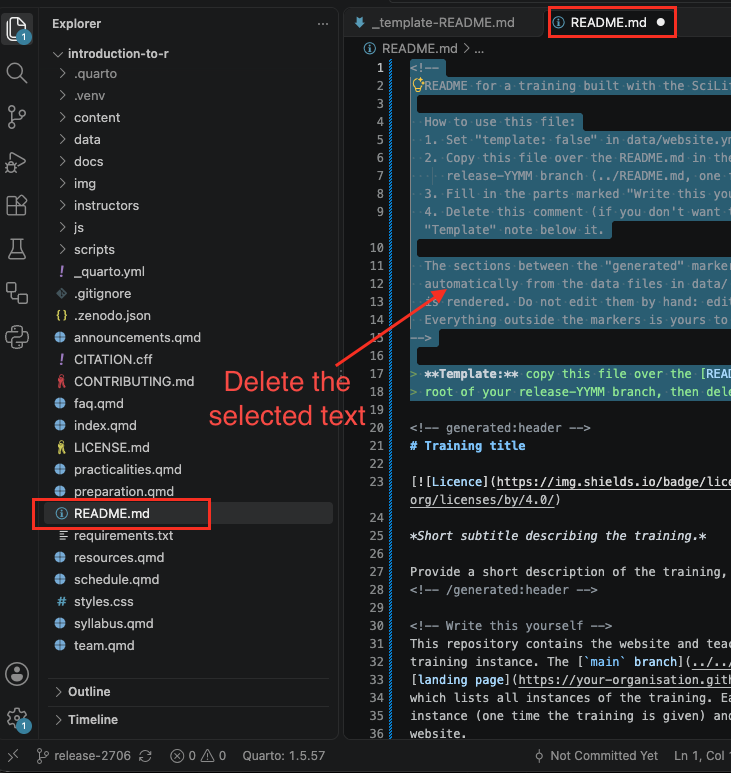{width=75% fig-alt="Screenshot: README.md file in repository root with template-README text copied and pasted into it"}

4. Fill in the parts marked **Write this yourself**, as on the landing
   page (see [the example](landing-page.qmd#readme-sections)). The other
   parts, between `<!-- generated:... -->` lines, are filled in
   automatically from your data files.
5. Save the file.

::: {.callout-note collapse="true"}
## Optional: delete docs/_template-README.md

You no longer need `docs/_template-README.md`. In the Explorer panel,
right-click the file and choose **Delete**. Keep the rest of the `docs`
folder.

   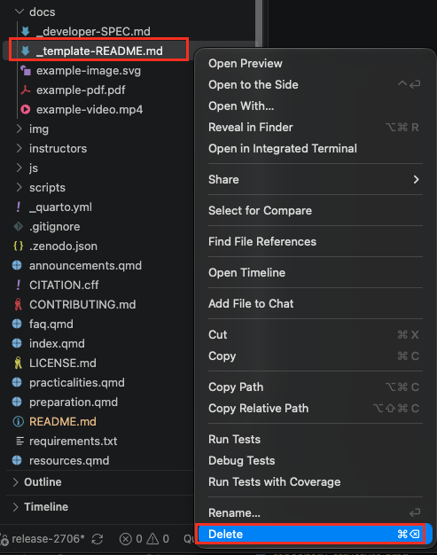{width=45% fig-alt="Screenshot: delete the template README in the docs folder"}

:::

### Remove the template banner {.unnumbered}
1. Open `data/website.yml`.
2. Change `template: true` to `template: false`.

   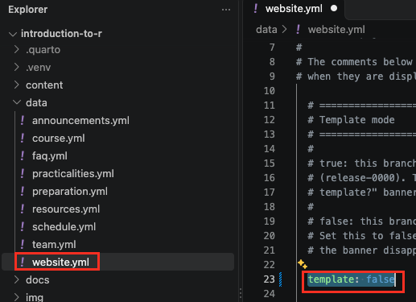{width=60% fig-alt="Screenshot: changed template:true to template:false in data/website.yml."}

3. Save the file.
4. The yellow [Want to use this template?]{.template-label} banner
disappears from the overview page, and all automatically generated files now describe your training instance's details. 

   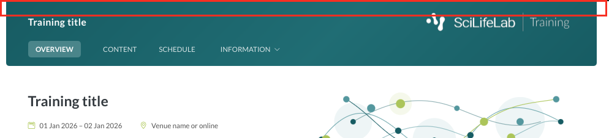{width=80% fig-alt="Screenshot: template banner gone on overview page."}

## Fill in the required data files {#required-information}

Now you can make the website of your training instance your own. Every
training instance **requires** three data files to be filled in: `website.yml`,
`course.yml` and `team.yml`. This section goes through them one by one.

### `website.yml`: the overview page  {.unnumbered}

`data/website.yml` mainly sets what appears on the **overview page**,
the first page of your training instance website. The figure below shows
the parts of the overview page, and their names:

   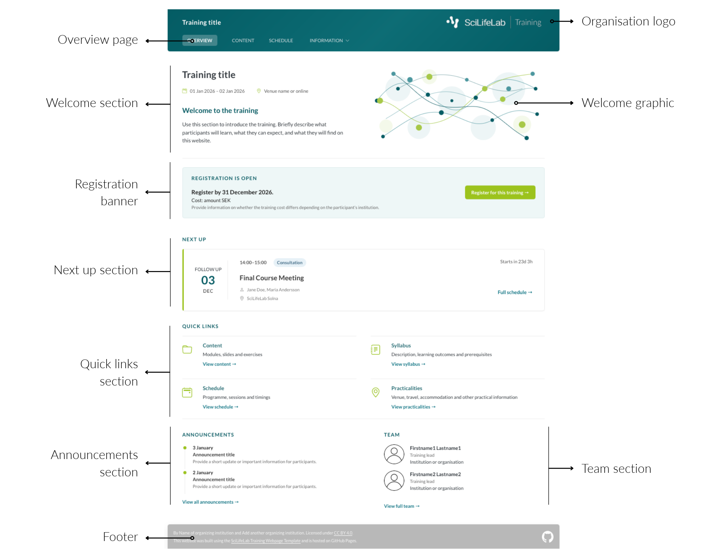{fig-alt="Screenshot: overview page with annotation of section."}

In `data/website.yml`, you set the **logos, the welcome section, the
registration banner and the texts of the quick links**. The other parts
of the overview page come from other data files.

Work through `data/website.yml` with the table below. The explanations
in the file, in the lines starting with `#`, give the rules for each
field: read them carefully. Many of the changes work the same as on the
landing page: see [Customise the look](landing-page.qmd#customise-the-look).

| Part of `website.yml` | What it sets | What to do |
|---|---|---|
| `navbar` → `logos` | The logos in the navigation bar | Copy the logo file into the `img` folder, and add its details below the existing logo in `logos` with `src`, `alt` and `height`.  |
| `welcome` | The title, text and image of the welcome section | Change `title` and `text`. For your own image, put it in the `img` folder, change `src` to its path, and describe it in `alt` |
| `registration` | The registration banner | Fill in `opening_date`, `closing_date`, the link under `url` and, if there is one, the fee under `cost`. Choose with `after_closing` whether the banner shows "closed" or disappears after registration closes. Without registration, set `enabled: false` |
| `pages` | The title, description and icon of each quick link | Change `title`, and `description` and pick an `icon` from [Bootstrap Icons](https://icons.getbootstrap.com/) |

: {tbl-colwidths="[20,30,50]"}

For example, this is `data/website.yml` filled in for a made-up training,
Introduction to R. The explanations starting with `#` are left out, so
the whole file fits on one screen:  

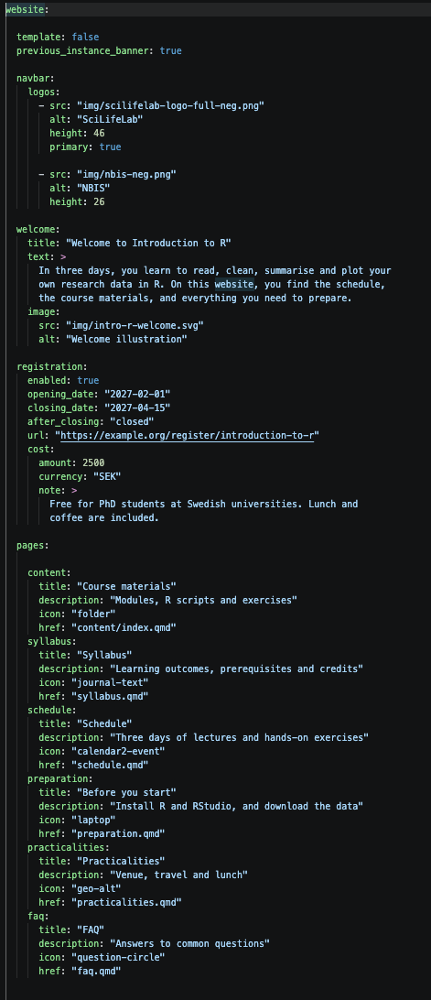{width=50% fig-alt="Screenshot: all values filled in for the mock course introduction to r in website.yml."}

After saving the file, the preview shows the overview page with this
information. 

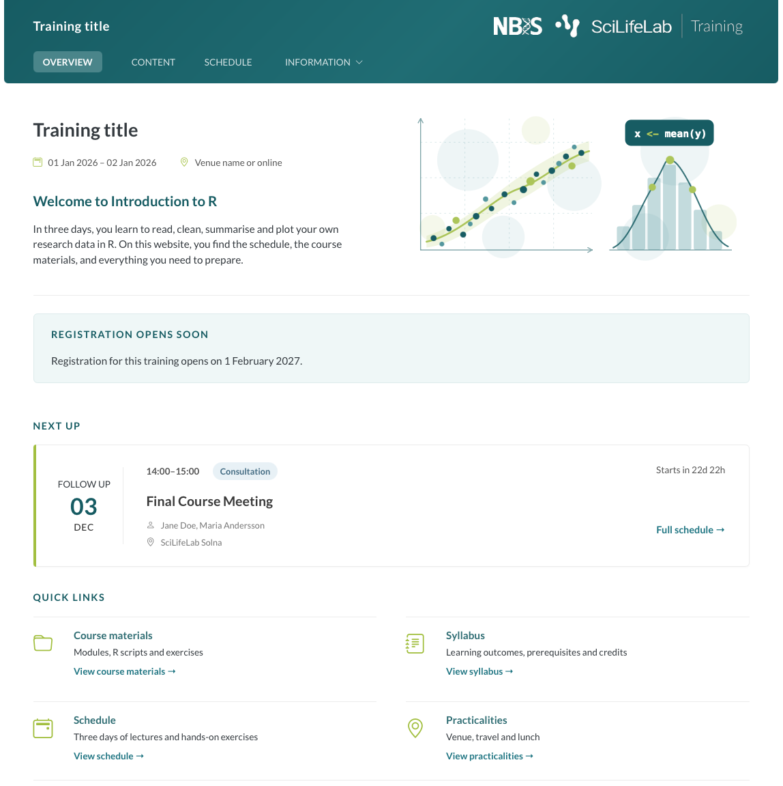{width=80% fig-alt="Screenshot: overview page with all the values for the mock course."}

There are two additional fields in `data/website.yml`: `footer` and `content`. Leave them as they are for now. The boxes below explain what they are for.

::: {.callout-note collapse="true"}
## About the footer

You don't need to change anything in the `footer` part of
`data/website.yml`. The footer fills itself in:

- **The organisation** ("By …") comes from `organizers` in
  `data/course.yml`.
- **The licence** ("Licensed under …") comes from `licence` and
  `licence_url` under `reuse` in `data/course.yml`.
- **The GitHub logo** links to your own repository, worked out
  automatically.

The `built_with` part credits the SciLifeLab Training Webpage Template,
which your website is built with. Leave it as it is.
:::

::: {.callout-note collapse="true"}
## About the content part

The `content` part at the bottom of `data/website.yml` lists the modules
of your training materials, and the order in which they appear in the
navigation. Leave it as it is for now: you'll change it when you add
your own materials, as described in
[Instance pages - Content](instance-pages-content.qmd).
:::

### `course.yml`: the training {.unnumbered}

`data/course.yml` describes your training instance, in the same way as
on the landing page. The information appears on the overview page, the
**Syllabus** page, the README and the citation of your training. It also
helps people find your training on Zenodo and in training registries
such as TeSS.

Use the same title, description, learning outcomes and keywords as on
the landing page, unless this training instance is different. The
landing page and the training instances then describe the same training.

As on the landing page, some fields in `data/course.yml` are
**required**, and some are optional. The explanations in the file, in
the lines starting with `#`, say which: read them carefully.

Work through `data/course.yml` with the table below. Required fields are
marked with **\***.

::: {.callout-important}
## Leaving out optional fields 
If an optional field doesn't apply to
your training, such as `credits` or `examination`, you can leave it out
in two ways:

- delete it: the field name and all lines that belong to it;
- leave it empty: nothing after the colon, `""` or `[]`.
:::

| Field | Where it appears | What to fill in |
|---|---|---|
| `title`**\***, `subtitle` | The navigation bar, the welcome section, the Syllabus page and the browser tab | The name of your training, and one sentence about it |
| `description`**\*** | The Syllabus page | What the training covers |
| `start_date`, `end_date` | The welcome section and the Syllabus page | The dates, as `"YYYY-MM-DD"` |
| `duration`, `mode`**\***, `instruction`, `location`**\*** | The welcome section and the Syllabus page | How long, online or in person, how participants learn, and where |
| `language`**\*** | The Syllabus page, the README and the citation | For example `"English"` |
| `target_audience`**\***, `expertise_level`, `prerequisites` | The Syllabus page | Who the training is for, and what they need to know or have before |
| `learning_outcomes`**\***, `keywords`**\*** | The Syllabus page and the citation | What participants can do afterwards, and a few terms that describe the subject |
| `credits`, `examination` | The Syllabus page | Credits, and how participants are assessed, if at all |
| `organizers`**\***, `content_providers`, `funding` | The Syllabus page and the footer; `organizers` also in the citation | The organisations behind the training |
| `contact` → `email`**\*** | The Syllabus page | The address participants send questions to |
| `reuse` → `licence`**\***, `licence_url` | The footer ("Licensed under …"), the README and the citation | CC BY 4.0 by default. Keep it, or change it. If you change it, also replace the text in `LICENSE.md` with the full text of your new licence |

: {tbl-colwidths="[25,30,45]"}

For example, this is `data/course.yml` filled in for Introduction to R. The explanations starting with # are left out, so the whole file fits on one screen:

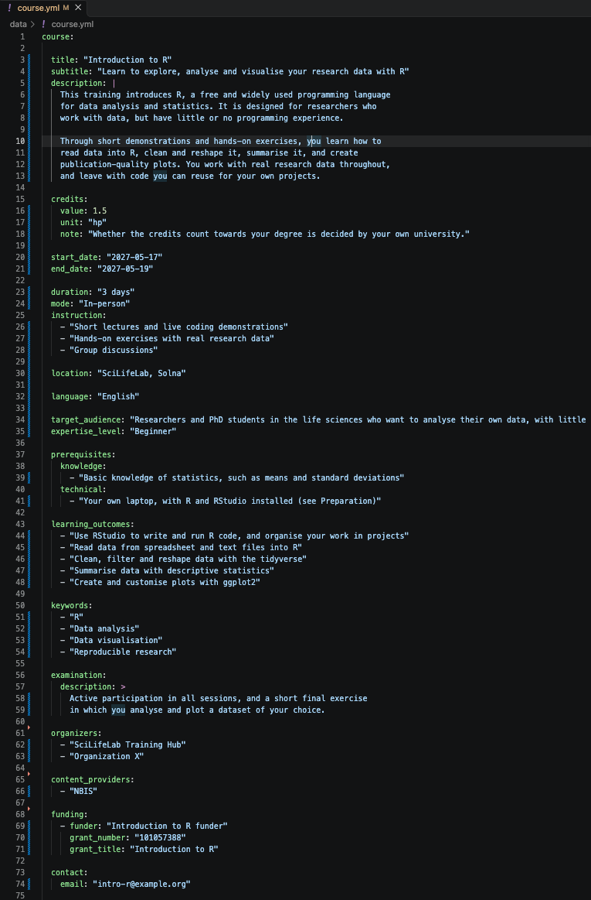{width=80% fig-alt="Screenshot: all values filled in for the mock course introduction to r in course.yml."}

After saving the file, the preview shows the information on the landing page: 

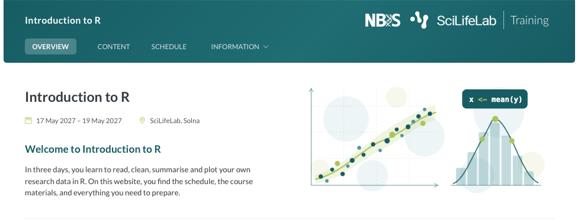{width=80% fig-alt="Screenshot: all values filled in for the mock course introduction to r in course.yml."}

and on the syllabus page: 

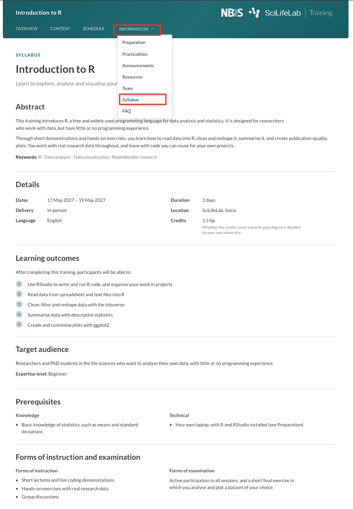{width=80% fig-alt="Screenshot: all values filled in for the mock course introduction to r in course.yml."}

The other fields under `reuse` can stay as they are for now. The box
below explains what they are for.

::: {.callout-note collapse="true"}
## About the other reuse fields

- `doi`, `version_doi`, `release_date` and `zenodo_communities` belong
  to publishing your training on Zenodo, and are explained in
  [FAIRification](fairification.qmd).
- `licence_id`, `version`, `website_url` and `preferred_citation` can
  stay empty for most trainings. The template works out the version and
  the address of your website from the branch name, and creates the
  citation from your team, title and DOI.

Did you create this training instance from an earlier one of your own?
Then `version_doi` and `release_date` may be filled in: empty them,
because they belong to the earlier training instance. Keep `doi`: it
stays the same for all your training instances.
:::

Is your training self-paced or in cohorts? Here are some tips for filling out `data/course.yml`. 

::: {.callout-note collapse="true"}
## Tips for self-paced training

- Leave out `start_date` and `end_date`.
- Use `duration` for the expected workload, for example
  `"About 10 hours"`.
- Set `mode` and `location` to `"Online"`.
- Describe how participants work in `instruction`, for example
  `"Self-study"`.
:::

::: {.callout-note collapse="true"}
## Tips for training in cohorts

It depends on how you set up your training instances (see
[Training instances](training-instances.qmd)):

- **One training instance per cohort:** fill in the dates of that
  cohort, as for any other training instance.
- **One training instance for several cohorts:** leave out `start_date`
  and `end_date`, and list the cohorts and their dates on the
  Announcements or Practicalities page instead.
:::

### The team: team.yml {.unnumbered}

The people in `data/team.yml` appear on the **Team** page, on the
Syllabus page, and in a team preview on the overview page. They are also
credited in the citation of the training instance.

Open `data/team.yml` and fill in each person. To **add** a person, copy
a whole entry, from `- given_names:` to the line before the next person,
paste it below, and change the values. To **remove** a person, delete
their whole entry.

::: {.callout-important}
- Every person needs `given_names`, `family_names`, `roles` and
  `affiliation`. The roles are `Training lead`, `Instructor` and
  `Contributor`.
- At least one person needs `course_contact: true` and an `email`:
  participants contact them with questions.
:::

The overview page shows up to two people: training leads first, then
instructors. Photos are optional: put them in the `img/photos` folder,
and add their path under `image`.

## Optional pages {#optional-pages}

The other data files are the flexible part of your training instance.
Which ones you need depends on your training: a self-paced training has
no schedule, an online training needs no practicalities about a venue,
and a short workshop may not need announcements.

| Page | Data file | Where it appears |
|---|---|---|
| **Schedule** | `data/schedule.yml` | Its own link in the navigation bar, and the **Next up** section on the overview page |
| **Announcements** | `data/announcements.yml` | The **Information** menu, and the two latest announcements on the overview page |
| **Practicalities** | `data/practicalities.yml` | The **Information** menu |
| **Preparation** | `data/preparation.yml` | The **Information** menu |
| **FAQ** | `data/faq.yml` | The **Information** menu |
| **Resources** | `data/resources.yml` | The **Information** menu |

: {tbl-colwidths="[20,30,50]"}

A page only appears when its data file contains information. **Team**
and **Syllabus** are always in the **Information** menu: they come from
the required files `team.yml` and `course.yml`.

Fill in the files you need, and leave out the others.

### Fill in a page {.unnumbered}

Each data file starts with an explanation of its page. Read it carefully
before you fill in the file: it describes what each field does, which
fields are required, and how the page behaves. It also has a part called
**Leaving information out**, which explains how to leave out one item or
a whole section without breaking the page.

::: {.callout-important collapse="true"}
## Using a schedule? Read this first

The schedule needs a bit more care than the other pages, because the
website uses its dates and times:

- Each event, such as a lecture, an exercise or a break, is one entry,
  from `- title:` to `content:`. Every event needs a `title`, `type`,
  `group`, `start` and `end`.
- Write dates and times exactly as explained in the file, for example
  `2027-05-12T09:00`, and use one of the event types listed there.
- Events with the same `group`, for example `"Day 1"`, are shown
  together, in order of their start time.
- To link an event to a page of your materials, fill in `content` with
  the path to that page, for example
  `"content/module-1/introduction.qmd"`.

The **Next up** section on the overview page then always shows the next
event, with a countdown, without you having to change anything during
the training.
:::

### Leave a page out {.unnumbered}

Delete its data file, or delete everything in it. The page and its link
in the navigation bar disappear by themselves.

::: {.callout-tip}
Changed your mind later? Every data file is still in the template, on
the **release-0000** branch. Copy it from there, or from one of your
earlier training instances.
:::

## Cheat sheet {#cheat-sheet}

All on the branch of your training instance.

| To... | Where | What to do |
|---|---|---|
| Switch off template mode (first instance only) | `data/website.yml` and `README.md` | Set `template: false`, and replace the README with `docs/_template-README.md` |
| Describe the training instance | `data/course.yml` | Fill in the required fields listed at the top of the file, and check the licence under `reuse` |
| Add the team | `data/team.yml` | One entry per person. At least one person with `course_contact: true` and an `email` |
| Set up the overview page | `data/website.yml` | `logos` under `navbar`, `welcome`, `registration` and `pages` |
| Fill in an optional page | `data/schedule.yml`, `announcements.yml`, `practicalities.yml`, `preparation.yml`, `faq.yml` or `resources.yml` | Read the explanation at the top of the file first |
| Leave out an optional page | The page's data file | Delete the file, or everything in it |

: {tbl-colwidths="[28,30,42]"}
