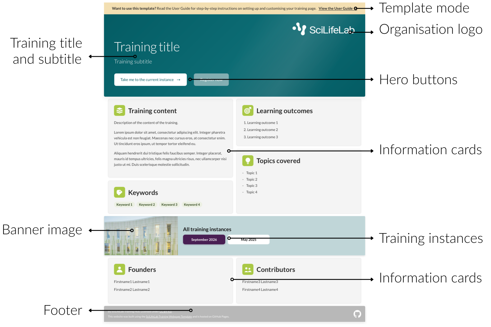
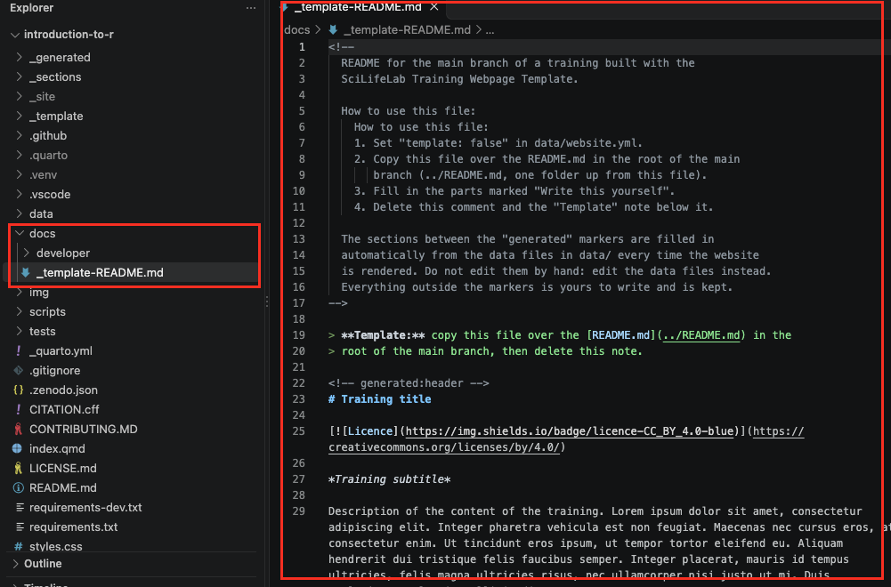
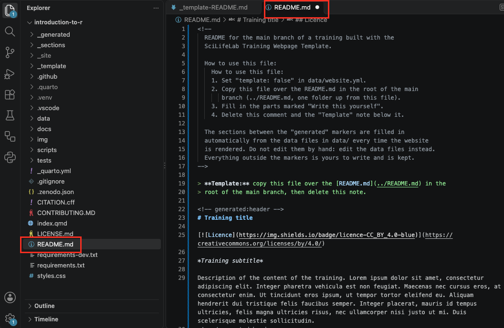
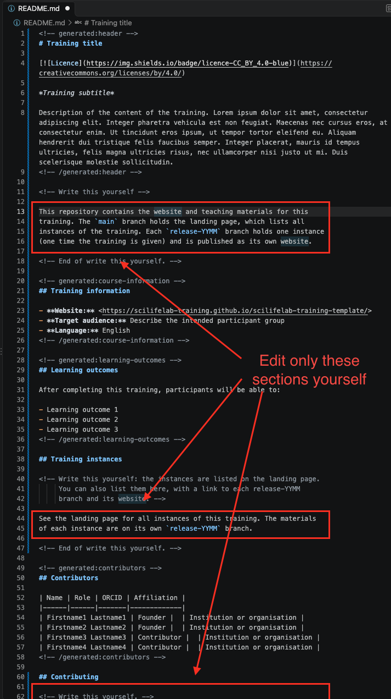
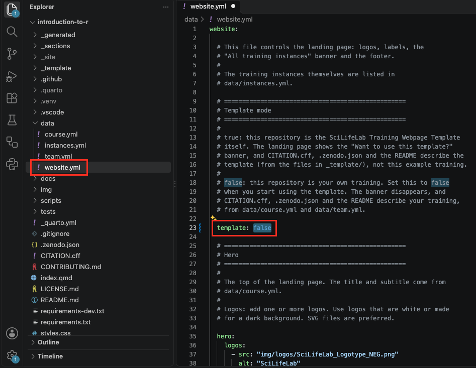
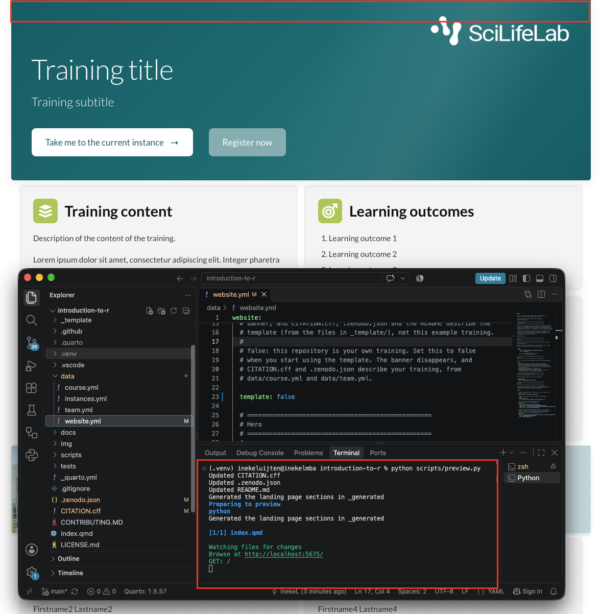

The [landing page](https://scilifelab-training.github.io/scilifelab-training-template/)
is the front door of your training. It introduces the training as a
whole, and helps visitors decide whether to register, or which training
instance to open.

The figure below shows the parts of the landing page, and the names this
guide uses for them.

{width=85% fig-alt="Annotated example of the landing page showing the template banner, training title and subtitle, logos, hero buttons, information cards, the All training instances banner with its image, and the footer."}

In this chapter, you will learn how to:

- [Switch off template mode](#switch-off-template-mode): replace the
  README and remove the template banner.
- [Customise the look](#customise-the-look): the organisation logos,
  the button texts, and banner image.
- [Describe your training](#describe-your-training): the title,
  subtitle, information cards, footer, and how others may
  reuse your training.

How to create a training instance and add it to the landing page is
explained in the next chapter, [Training instances](training-instances.qmd).

### Before you start {.unnumbered}

Everything in this chapter happens on the **main** branch, and almost
all of it in three data files in the `data` folder:

| Data file | What it holds |
|---|---|
| `data/course.yml` | The title, description, learning outcomes, keywords and topics of your training, and the organisation and licence shown in the footer |
| `data/team.yml` | The people behind the training |
| `data/website.yml` | Template mode, logos, button texts and banner image |

: {tbl-colwidths="[30,70]"}  

Not sure how a data file works? See [Data files](repository-structure.qmd#data-files).

Work as described in [Regular workflow](workflow.qmd):

1. In a new terminal, start the preview:

```bash
   python scripts/preview.py
```

2. Make your changes, save them, and check the result in your browser.
3. [Commit and push](workflow.qmd#commit-and-push-your-changes) your
   changes. You don't have to do this after every change: you can make
   several changes, and then commit and push them together.

The [cheat sheet](#cheat-sheet) at the end of this chapter sums up which
file to open and what to change for each part of the landing page.


## Switch off template mode

Your repository starts as a copy of the template, so it still presents
itself as the template, in two places:

- the `README.md` file, the description shown on your repository's main
  page on GitHub, which still describes the template instead of your
  training;
- the yellow [Want to use this template?]{.template-label} banner at the
  top of the landing page (see the overview image above).

In this section, you replace the README and then switch off
**template mode**, so your repository presents your own training.

### Replace the README {.unnumbered}

The template comes with a ready-made README for your training, in
`docs/_template-README.md`. Copy it over the current README, which
describes the template: 

1. In the Explorer panel, open the `docs` folder and then
   `_template-README.md`.

   {width=85% fig-alt="Screenshot: template-README.md file in docs/ folder"}

2. Select all text (**Cmd+A** or **Ctrl+A**) and copy it.
3. Open `README.md` in the main folder of your repository, select all
   text, and paste, so the copied text replaces it.

   {width=85% fig-alt="Screenshot: README.md file in repository root with template-README text copied and pasted into it"}

4. Delete the note at the top of the file, between `<!--` and `-->`,
   and the line starting with `> **Template:**`.
5. Fill in the parts marked **Write this yourself**. The other parts,
   between `<!-- generated:... -->` lines, are filled in automatically
   from your data files.
6. Save the file.

   {width=70% fig-alt="Screenshot: show which sections of the README to edit"}
   
### Remove the template banner {.unnumbered}

1. Open `data/website.yml`.
2. Find the line:

   ```yaml
   template: true
   ```

3. Change it to:

   ```yaml
   template: false
   ```

   {width=80% fig-alt="Screenshot: changed template:true to template:false in data/website.yml."}

4. Save the file with **Cmd+S** (macOS) or **Ctrl+S** (Windows and Linux).

This changes three things:

- The yellow banner disappears from the landing page.
- The generated parts of your new README now show your training's
  details, from your data files.
- `CITATION.cff` and `.zenodo.json` now describe your training instead
  of the template.

   {width=80% fig-alt="Screenshot: changed template:true to template:false in data/website.yml."}

::: {.callout-note collapse="true"}
## Optional: delete the template files you no longer need

Two things on main are only needed while you set up your repository:

- The `docs/_template-README.md` file (keep the rest of the `docs` folder)
- The `_template` folder

You can delete both: in the Explorer panel, right-click each and choose
**Delete**. 

If you ever set `template: true` again, the preview stops with an
error, because the `_template` folder is missing.
:::

::: {.callout-tip}
The README shows the details you have filled in so far. Did you not
fill in the data files yet? No problem: the README updates by itself
every time you change them.
:::

## Customise the look

You can make the landing page your own by changing the organisation logos, the button texts and the banner image. All of these are in `data/website.yml`. Open it, and work through the parts below.

### Logos {.unnumbered}

The logos in the hero show the organisations behind your training. The
SciLifeLab logo is always shown on the right. Your other logos appear to
its left.

**Add a logo**

1. Save your logo as an **SVG** or **PNG** file.

   ::: {.callout-tip}
   Use a **white** version of your logo, or one made for a dark
   background, so it stands out against the dark hero.
   :::

2. Copy the file into the `img/logos` folder: drag it from your computer
   onto the folder in the Explorer panel in VS Code.
3. In `data/website.yml`, find the `hero` part:

   ```yaml
   hero:
     logos:
       - src: "img/logos/SciLifeLab_Logotype_NEG.png"
         alt: "SciLifeLab"
         height: 56
         primary: true
   ```

4. Add your logo below the existing one, with these lines:
   - `src`: where the file is: `img/logos/` followed by the file name;
   - `alt`: the name of the organisation;
   - `height` (optional): the height of the logo in pixels, 56 if you
     leave it out.

   For example:

IMAGE

5. Save the file, and check the preview. If the logos look like
   different sizes, adjust their `height` until they look about the
   same.

The logo with `primary: true` (SciLifeLab) is always shown on the right.
Your other logos appear to its left, in the same order as in the list.

**Remove a logo**

1. In `data/website.yml`, delete all lines of the logo you want to
   remove, from `- src:` to its last line.
2. Save the file.
3. Optional: if you no longer need the logo file, delete it from the
   `img/logos` folder. In VS Code, right-click the file and choose
   **Delete**.

### Button texts {.unnumbered}

You can change the text on the two hero buttons, and the heading of the
**All training instances** banner:

1. In `data/website.yml`, find the `labels` part:

   ```yaml
   labels:
     hero_view_current_label: "Take me to the current instance"
     hero_registration_open_label: "Register now"
     instances_band_title: "All training instances"
   ```

2. Change the text between the quotation marks. For example:

   ```yaml
   hero_view_current_label: "Go to the latest training"
   hero_registration_open_label: "Sign up"
   ```

3. Save the file.

This only changes the texts. Where the buttons lead, and when they are
shown, is set in `data/instances.yml`: see
[Training instances](training-instances.qmd).

### Banner image {.unnumbered}

The **All training instances** banner shows a decorative image next to
the buttons. You can replace it with an image that fits your training.

1. Copy your image into the `img/images` folder: drag it from your
   computer onto the folder in the Explorer panel in VS Code.

   ::: {.callout-tip}
   Use a landscape image. The image is cropped automatically to fill
   the space, so keep the important part near the middle.
   :::

2. In `data/website.yml`, find:

   ```yaml
   instances_band:
     image: "img/images/navet-band.png"
   ```

3. Replace `navet-band.png` with the file name of your image, for
   example:

   ```yaml
   instances_band:
     image: "img/images/my-training-banner.jpg"
   ```

4. Save the file, and check the preview at different widths of your
   browser window.

To show no image at all, change it to `image: ""`.

::: {.callout-tip collapse="true"}
## Is the important part of your image cut off?

You can choose which part of the image stays visible. This is the only
change in this guide in `styles.css`, the file that controls the look of
the website, so make it carefully:

1. Open `styles.css` and search for `.instances-band__image`
   (**Cmd+F** or **Ctrl+F**).
2. In that block, find:

   ```css
   object-position: center;
   ```

3. Change `center` to the part you want to keep. For example,
   `center top` keeps the top of the image, and `30% center` moves the
   visible part to the left.
:::

## Describe your training

What the landing page says about your training comes from two data
files: `data/course.yml` describes the training, and `data/team.yml` the
people behind it. The information you enter in these files is also used in the README and
the citation of your training, and helps people find it in Zenodo and
training registries such as TeSS.

Both files contain explanations at the top and between the fields,
in the lines starting with `#`. This section covers the main points;
the explanations in the files give the details.

### How to fill in a data file {.unnumbered}

You only change the **values**: the text after the colon. See
[Data files](repository-structure.qmd#data-files) for how a data file is
built. Values come in three forms:

**A single line of text**, between quotation marks:

```yaml
title: "Introduction to R"
```

**Several paragraphs**, after `|`. Start each line with the same number
of spaces, and separate paragraphs with an empty line:

```yaml
description: |
  This training introduces R, a free and widely used programming
  language for data analysis.

  Through short demonstrations and hands-on exercises, you learn how to
  read, clean, summarise and plot your data.
```

**A list**: each line starting with `-` is one item. To add an item,
copy a whole line, paste it below, and change the text. To remove an
item, delete its whole line:

```yaml
keywords:
  - "R"
  - "Data analysis"
  - "Data visualisation"
```

### The training: course.yml {.unnumbered}

Open `data/course.yml` and work through it from top to bottom:

| Field | Where it appears | What to fill in |
|---|---|---|
| `title` | The hero, and the browser tab | The name of your training |
| `subtitle` | The hero, below the title | One sentence about the training (optional) |
| `description` | The **Training content** card | What the training covers, in a few paragraphs |
| `learning_outcomes` | The **Learning outcomes** card | What participants can do after the training |
| `keywords` | The **Keywords** card | Four or five short terms that describe the subject |
| `topics` | The **Topics covered** card | The main topics, as short phrases |
| `language`, `target_audience`, `expertise_level`, `organizers`, `funding` | Not on the landing page: in the README, the citation and the information for training registries | See the explanations in the file |
| `licence`, `licence_url` (under `reuse`) | The footer ("Licensed under …"), the README and the citation | CC BY 4.0 by default. |

: {tbl-colwidths="[25,30,45]"}

The other fields under `reuse` can stay empty for now:

- `doi`, `release_date` and `zenodo_communities` belong to publishing your training on Zenodo, and are explained in
  [FAIRification](fairification.qmd).
- `licence_id`, `website_url` and `preferred_citation` can stay empty for most trainings. The template works out the address 
   of your website, and creates the citation from your team, title and DOI.

Example of a filled-in `course.yml`:

IMAGE

::: {.callout-tip}
- **Subtitle**: keep it to one sentence, and start it with an action
  verb such as **Learn**, **Understand**, **Explore**, **Build** or
  **Apply**.
- **Learning outcomes** describe what participants will be able to do after the training. For guidance, see the
  [SciLifeLab Training Hub resources on writing learning outcomes](https://figshare.scilifelab.se/articles/educational_resource/Training_Hub_Resources_for_Learning_Outcomes/28473218).
- **Optional fields**: to leave out the subtitle, use `subtitle: ""`. To
  leave out the funding, keep `funding: []`.
- **Licence**: if you change it, also replace the text in `LICENSE.md`
  in the main folder of your repository with the full text of your new licence.
:::

### The team: team.yml {.unnumbered}

The **Founders** and **Contributors** cards at the bottom of the landing
page list the people in `data/team.yml`. They are also credited in the
README and the citation of your training.

Open `data/team.yml` and fill in each person. The comments at the top of
the file explain every field. To **add** a person, copy a whole entry,
from `- given_names:` to the line before the next person, paste it below,
and change the values. To **remove** a person, delete their whole entry.

Example of a filled-in `team.yml`:

IMAGE

::: {.callout-important}
Every person needs `given_names`, `family_names`, `roles` (`Founder` or
`Contributor`) and `affiliation`. If one is missing, the preview shows
an error that names the person and the missing field.
:::

## Cheat sheet

### Switch off template mode {.unnumbered .unlisted}

| To... | Where | What to do |
|---|---|---|
| Replace the README | `README.md` | Replace its contents with `docs/_template-README.md`, and fill in the parts marked **Write this yourself** |
| Remove the template banner | `data/website.yml` | Set `template: false` |

### Customise the look {.unnumbered .unlisted}

| To... | Where | What to do |
|---|---|---|
| Add a logo | `img/logos/` and `data/website.yml` | Copy the file into the img folder, and add `src`, `alt` and `height` lines under `hero:` → `logos:` |
| Change the size of a logo | `data/website.yml` | `height` of the logo, in pixels |
| Remove a logo | `data/website.yml` | Delete all lines of the logo |
| Change the button texts | `data/website.yml` | `hero_view_current_label` and `hero_registration_open_label` under `labels` |
| Change the heading of the banner | `data/website.yml` | `instances_band_title` under `labels` |
| Change the banner image | `img/images/` and `data/website.yml` | Copy the image into the img folder, and change `image` under `instances_band` |
| Show no banner image | `data/website.yml` | Set `image: ""` under `instances_band` |

### Describe your training {.unnumbered .unlisted}

| To... | Where | What to do |
|---|---|---|
| Change the title and subtitle | `data/course.yml` | `title` and `subtitle` |
| Change the training content | `data/course.yml` | The text under `description` |
| Change the learning outcomes, keywords or topics | `data/course.yml` | The lists under `learning_outcomes`, `keywords` and `topics` |
| Leave out the subtitle or funding | `data/course.yml` | Set `subtitle: ""` or `funding: []` |
| Change the organisation in the footer | `data/course.yml` | `organizers` |
| Change the licence | `data/course.yml` | `licence` and `licence_url` under `reuse`. Also replace `LICENSE.md` |
| Add or change founders and contributors | `data/team.yml` | Add or edit a person, with `roles` set to `Founder` or `Contributor` |
