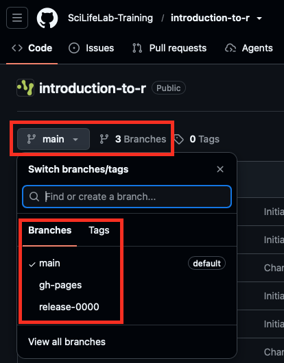
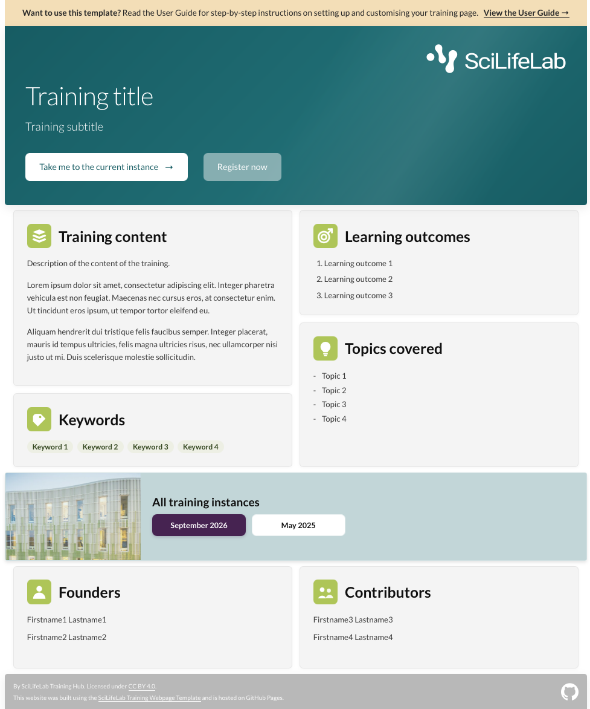
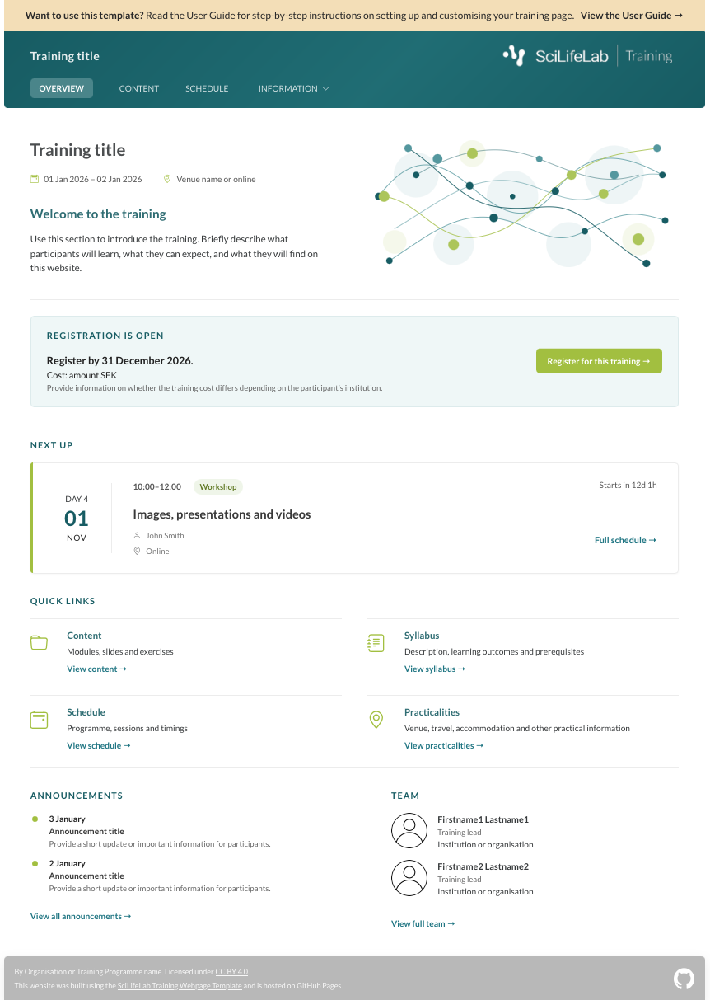
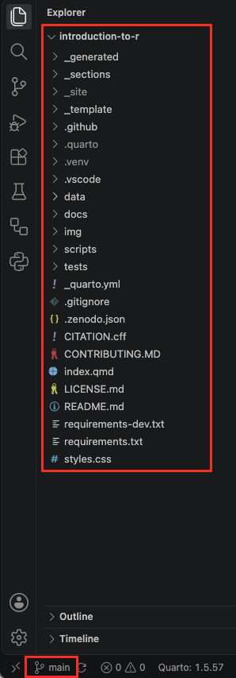
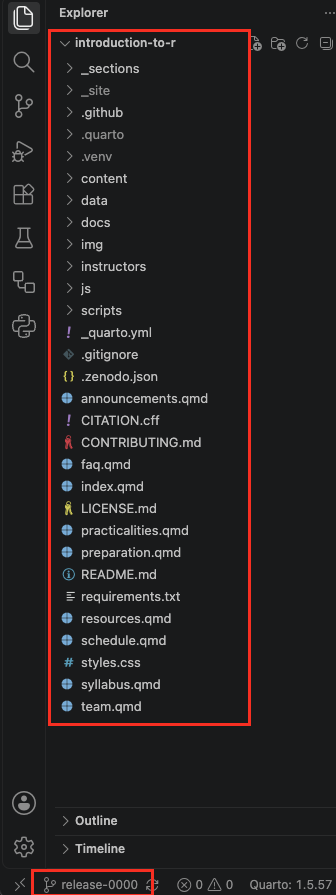
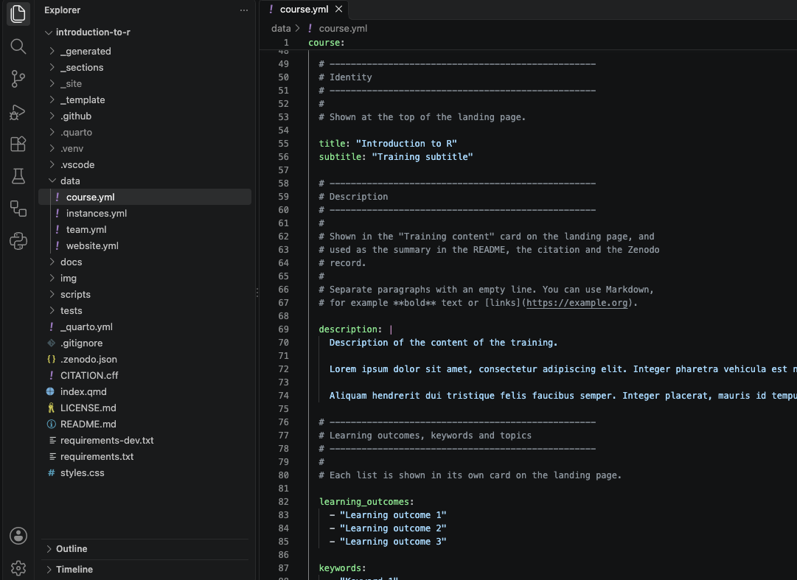

You now know the routine for making a change and publishing it, from
[Regular workflow](workflow.qmd). You're ready to make the template your
own, with the information and materials of your training.

Before you start, it helps to know how your repository is organised.
This chapter shows you where everything lives, so you always know where
to make a change, and which files you don't need to edit.

<br>

## Branches

Your training repository is divided into **branches**. Each branch holds
the files for one part of your website. A new repository made from the
template has three branches: **main**, **release-0000** and
**gh-pages**.

{width=35% fig-alt="Screenshot: Github showing repository branches."}

Each of these branches holds the files for one part of your website:

- The **main** branch holds the **landing page**: the general page about
  your training, with its description, learning outcomes and team, and
  links to every time the training is given.  
     {width=60% fig-alt="Screenshot: landing page."}

- The **gh-pages** branch holds the **published website**: the finished
  pages that visitors see. GitHub builds them from your other branches
  and updates this branch automatically every time you push a change.

::: {.callout-warning}
Never edit the **gh-pages** branch yourself. GitHub updates it
automatically every time you push a change to one of the other
branches.
:::

- The **release-0000** branch is an example **training instance**: the
  website for one time the training is given, with its dates, schedule,
  practical information, team and training materials. You use it as the
  starting point for each new training instance, which gets a branch of
  its own.   
     {width=60% fig-alt="Screenshot: training instance page."}

Because each training instance has its own branch, you can prepare the
next training without changing the website of an earlier one.
Participants of earlier trainings can always go back to the materials
as they were.

### Branch names {.unnumbered}

A training instance branch is named **release-** followed by the year
and month of the training, written as YYMM. For example,
**release-2705** is the training in May 2027.

### An example {.unnumbered}

This is what the branches look like in a repository for a training
that has been given twice, in May 2026 and May 2027:

```text
Your repository
│
├── main              The landing page: the general page about your
│                     training, with links to every training instance.
│
├── release-2605      The website of your training in May 2026.
├── release-2705      The website of your training in May 2027.
│
├── release-0000      The example training instance that comes with
│                     the template.
│
└── gh-pages          The published website. Updated automatically.
```

In this repository, you would work on these branches:

| I want to... | I work on branch... |
|---|---|
| Change the landing page | `main` |
| Edit the materials of the May 2026 training | `release-2605` |
| Fix a typo on the May 2027 website | `release-2705` |
| Set up the next training instance | A new `release-` branch: see [Training instances](training-instances.qmd) |

::: {.callout-note}
You work on one branch at a time. To learn how to switch to another
branch in VS Code, see
[Switch branch](workflow.qmd#switch-branch).
:::


## Three kinds of files

When you open a branch of your repository in VS Code, you see many files and
folders. Don't worry: you only have to work with a few of them. On all branches, the files fall
into three groups:

| Icon | Kind | What it means for you |
|---|---|---|
| ✏️ | **Files you edit** | Your information and materials. This is where you make your changes. |
| 🔄 | **Files that are updated automatically** | The template creates and updates these files automatically. You should not edit them, but if you accidentally do, your edits will automatically be overwritten. |
| 🔒 | **Files you can leave alone** | The parts that make the template work, you never need to change these. |

: {tbl-colwidths="[8,30,62]"}

::: {.callout-tip}
The automatically updated files 🔄 often appear in the Source Control
panel when you only changed a data file. That's expected: commit them
together with your own changes, as described in
[Commit and push your changes](workflow.qmd#commit-and-push-your-changes).
:::

## Files on the main branch

On the **main** branch, everything for your training's landing page
lives in these files and folders:

{width=40% fig-alt="Screenshot: files in the main branch."}

The table below explains what each one is for, and whether you edit it
✏️, it's updated automatically 🔄, or you can leave it alone 🔒.

| File or folder | What it contains | Kind of file |
|---|---|:---:|
| `data/course.yml` | The title, description, learning outcomes and keywords of your training, and how others may reuse and cite it | ✏️ |
| `data/team.yml` | The people behind the training | ✏️ |
| `data/website.yml` | The logos, button texts and footer of the landing page | ✏️ |
| `data/instances.yml` | The list of training instances, with links to their websites | ✏️ |
| `img/` | The images and logos used on the landing page | ✏️ |
| `README.md` | The description shown on your repository's main page on GitHub. The parts between `<!-- generated:... -->` lines are updated automatically; you can edit the rest | ✏️ 🔄 |
| `_generated/` | The sections of the landing page, built from your data files | 🔄 |
| `CITATION.cff` | How to cite your training, built from your data files | 🔄 |
| `.zenodo.json` | The information Zenodo uses when you publish your training, built from your data files | 🔄 |
| `LICENSE.md` | The full text of the licence of your training: CC BY 4.0, unless you choose another licence in `data/course.yml`. Only replace it if you do | ✏️🔒 |
| `index.qmd`, `_sections/` | The building blocks that put the landing page together | 🔒 |
| `styles.css` | The look of the website: colours, fonts and layout | 🔒 |
| `_template/` | Information about the template itself, used only by the template's own website | 🔒 |
| `scripts/`, `tests/` | The scripts that build the website, and the checks that test them | 🔒 |
| `.github/` | The automatic processes that publish your website on GitHub | 🔒 |
| `docs/` | Documentation for developers of the template | 🔒 |
| `.vscode/` | Settings for VS Code, such as the extensions it recommends when you open the repository | 🔒 |
| `.gitignore` | The list of files that stay on your computer and are never uploaded to GitHub, such as your preview and environment | 🔒 |
| `_quarto.yml`, `requirements.txt`, `requirements-dev.txt` | Settings for Quarto, and the Python packages the scripts need | 🔒 |

: {tbl-colwidths="[29,55,16]"}

When you preview your website, a few more folders appear on your
computer: `_site/` (the website itself), `.quarto/` and `.venv/` (your
environment). They are listed in `.gitignore`, so they are never
uploaded to GitHub, and you can ignore them.

## Files on a training instance branch

A **training instance** branch has the same structure as **main**, plus
the information pages of the training instance website and your
training materials.

{width=40% fig-alt="VS Code Explorer panel showing the files and folders of a training instance branch."}

The table below explains what each one is for, and whether you edit it
✏️, it's updated automatically 🔄, or you can leave it alone 🔒.

| File or folder | What it contains | Kind of file |
|---|---|:---:|
| `data/course.yml` | The title, dates, location and description of this training instance, and how others may reuse and cite it (required)| ✏️ |
| `data/team.yml` | The organisers, instructors and helpers (required)| ✏️ |
| `data/website.yml` | The logos, texts and sections of the overview page, and the footer (required)| ✏️ |
| `data/schedule.yml` | The schedule of the training (optional) | ✏️ |
| `data/announcements.yml`, `practicalities.yml`, `preparation.yml`, `faq.yml`, `resources.yml` | The information pages (optional) | ✏️ |
| `content/` | Your training materials, with one folder per module | ✏️ |
| `img/` | The images, logos and photos used on the website | ✏️ |
| `README.md` | The description shown on your repository's main page on GitHub. The parts between `<!-- generated:... -->` lines are updated automatically; you can edit the rest | ✏️ 🔄 |
| `CONTRIBUTING.md` | How participants can suggest improvements to your training. Ready to use, but you can adapt it if you like | ✏️ 🔒 |
| `LICENSE.md` | The full text of the licence of your training: CC BY 4.0, unless you choose another licence in `data/course.yml`. Only replace it if you do | ✏️🔒 |
| `_generated/` | The sections of the website, built from your data files | 🔄 |
| `CITATION.cff`, `.zenodo.json` | How to cite this training instance, and the information Zenodo uses, built from your data files | 🔄 |
| `index.qmd`, `schedule.qmd`, `team.qmd` and the other `.qmd` files | The pages of the website. They collect their content from your data files | 🔒 |
| `_sections/`, `js/`, `styles.css` | The building blocks, interactive parts and look of the website | 🔒 |
| `scripts/`, `.github/`, `docs/` | The scripts that build the website, the automatic processes that publish it, and documentation for developers of the template | 🔒 |
| `_quarto.yml`, `requirements.txt`, `.gitignore` | Settings for Quarto, the Python packages the scripts need, and the list of files that are never uploaded to GitHub | 🔒 |

: {tbl-colwidths="[30,55,15]"}

When you preview your website, a few more folders appear on your
computer: `_site/` (the website itself), `.quarto/` and `.venv/` (your
environment). They are listed in `.gitignore`, so they are never
uploaded to GitHub, and you can ignore them.

## Data files {#data-files .unnumbered}


As the tables above show, most of the files you edit are **data files**:
the files ending in `.yml` in the `data` folder.

When you open a data file, for example `data/course.yml` on the
**main** branch, you see three kinds of text. VS Code shows each in its
own colour:

{width=90% fig-alt="The top of data/course.yml in VS Code, with explanations in grey, field names in green and values in blue."}

- **Explanations** (grey in the screenshot): lines that start with `#`.
  They explain how the file works and what each field does, and don't
  appear on your website. You can delete them if you prefer a shorter
  file, but they are useful to keep while you are getting to know the
  template.
- **Field names** (green): the word before the colon, for example
  `title:`. They tell the template where each piece of information goes
  on your website. **Never change field names.** If you do, the template
  can't find that information any more.
- **Values** (blue): the text after the colon, usually between quotation
  marks. **This is what you change.** It is the information that appears
  on your website.

For example, in this line:

```yaml
title: "Training title"
```

`title` is the field name: leave it as it is. `"Training title"` is the
value: replace it with the title of your training.

::: {.callout-note}
The colours depend on the colour theme you use in VS Code, so yours may
look different from the screenshot. The rule is always the same: lines
starting with `#` are explanations, the word before the colon is the
field name, and the text after the colon is the value you change.
:::

::: {.callout-warning}

**Keep the layout**

Data files are very sensitive to layout:

- Keep the **spaces at the start of each line** exactly as they are.
  They show which information belongs together.
- Keep the **quotation marks** around values.
- Lines starting with `-` are **list items**. To add an item, copy a
  whole line and change its value.

If the preview shows an error after you save a data file, check these
first. The error message usually names the file and the line.

:::

## Next steps {.unnumbered .unlisted}

Now that you know your way around, continue with:

- [Landing page](landing-page.qmd): describe your training on the
  landing page.
- [Training instances](training-instances.qmd): create the website for
  each time your training is given.
- [FAIRification](fairification.qmd): make your training citable and
  findable.

<br>

::: {.guide-footer}
---

This User Guide is maintained by the SciLifeLab Training Hub.   
Questions, problems or ideas for improving the guide or the template?
[Open an issue](https://github.com/SciLifeLab-Training/scilifelab-training-template/issues)
or email us at [training@scilifelab.se](mailto:training@scilifelab.se).
:::