To turn the SciLifeLab Training Webpage Template into a website for your
own training, you first need your own copy of the template. This chapter takes you
through everything you need to do **once**, at the start: you will create
your own copy, publish it as a website, and set it up on your computer so
you can edit it.

The figure below shows the steps you will follow:

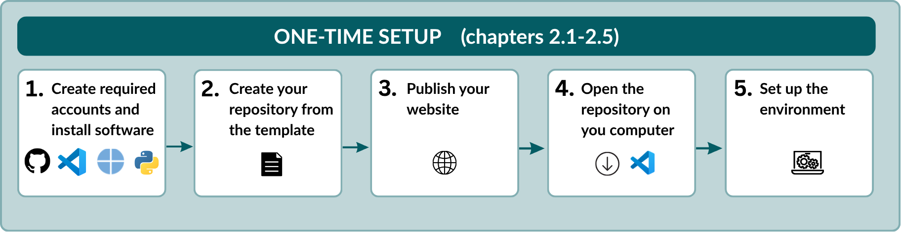{fig-alt="Workflow showing the one-time setup steps."}

Once you are done, the next chapter, [Regular workflow](workflow.qmd),
shows the steps you repeat every time you want to update your training website.


## Install the software

To work with the template, you need a free GitHub account and four free
programs. If you already have some of them, you can skip those. Install each program with the default settings. 

| What | What it does for you | Where to get it |
|---|---|---|
| GitHub account | Stores your training online and publishes the website | <https://github.com> |
| Visual Studio Code | The program you use to edit files and upload your changes | <https://code.visualstudio.com/> |
| Git | Copies files between your computer and GitHub, in the background | <https://github.com/git-guides/install-git> |
| Python | Runs the small scripts that build your website | <https://www.python.org/downloads/> |
| Quarto | Turns your files into a website, and shows you a preview | <https://quarto.org/docs/get-started/> |


::: {.callout-note}
If your training will be hosted in a GitHub organisation, such as
[SciLifeLab-Training](https://github.com/SciLifeLab-Training) or
[NBISweden](https://github.com/NBISweden), ask an administrator of that
organisation to add your GitHub account before you continue.
:::

::: {.callout-note}
This guide uses VS Code for all editing and uploading. You can use
another editor if you prefer, but the instructions and screenshots assume
VS Code.
:::

## Create your repository

A **repository** is the folder on GitHub that holds everything for your
training: the information about it, the materials, and the website. Follow these steps to
create your own repository as a copy of the template:

1. Open the
   [SciLifeLab Training Webpage Template](https://github.com/SciLifeLab-Training/scilifelab-training-template)
   on GitHub.
2. In the top-right corner of the page, click the green
   **Use this template** button and select **Create a new repository**.

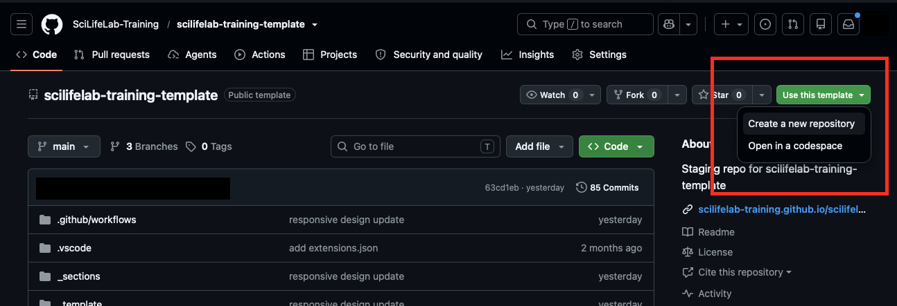{fig-alt="GitHub repository page showing the Use this template button."}

3. Fill in the form:
   - Turn **Include all branches** **on**. This is required!
   - Under **Owner**, select the GitHub organisation or account where the
     repository should live, for example SciLifeLab-Training, NBISweden,
     or your personal account.
   - Under **Repository name**, enter a short name in lowercase, with
     hyphens instead of spaces, for example `introduction-to-r`. The name
     becomes part of your website address, so choose it carefully.
   - Under **Visibility**, choose **Public**, so participants can see the
     website and materials.
4. Click **Create repository**.

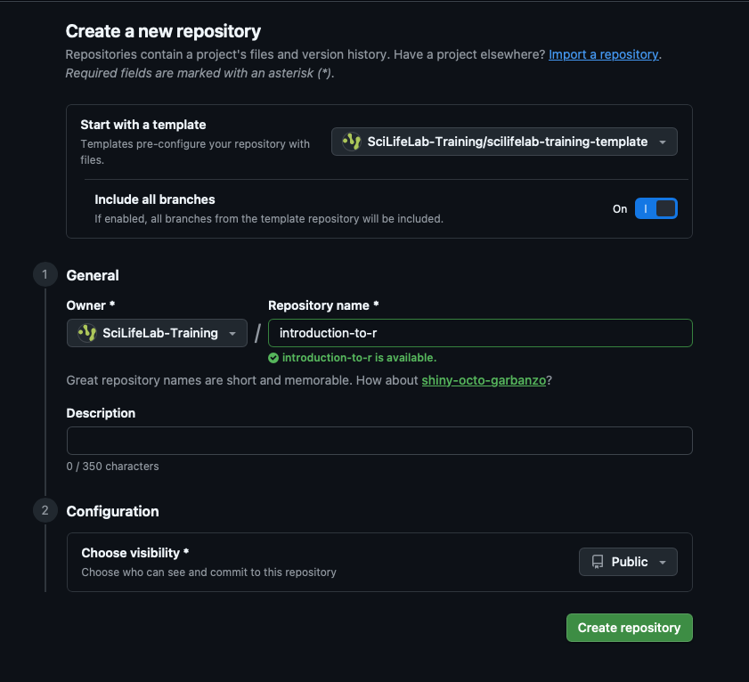{width=70% fig-alt="GitHub form for creating a repository from a template, including the owner, repository name, visibility and Include all branches options."}

GitHub now opens your new repository. Check the name at the top of the
page: it should be the name you just chose, not the template's name.

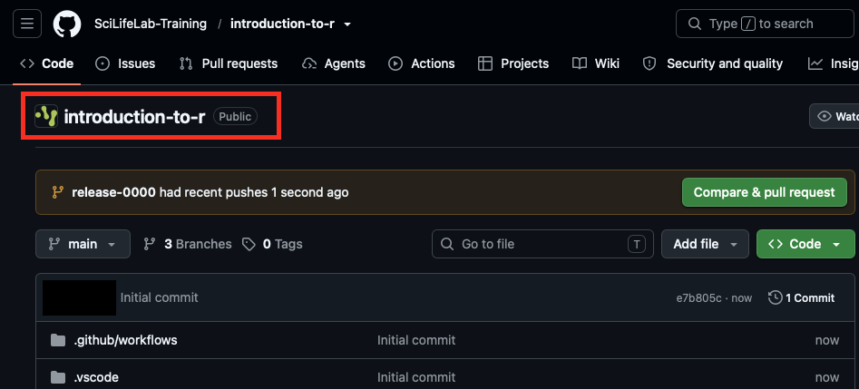{width=70% fig-alt="GitHub page showing a newly created repository based on the template."}


::: {.callout-tip collapse="true"}
## Working with others? Add collaborators (optional)

If other people will help develop or maintain the training, give them
access to the repository. You can also come back to this later.

1. In your repository, click **Settings**.
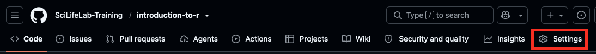{fig-alt="GitHub page showing the link to setup."}
2. Under **Access** in the menu on the left, click
   **Collaborators and teams**.
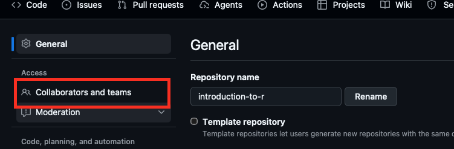{fig-alt="GitHub settings page showing the links to collaborators and teams."}
3. Click **Add people** or **Add teams**.
4. Search for the person or team, choose a role, and click **Add**.
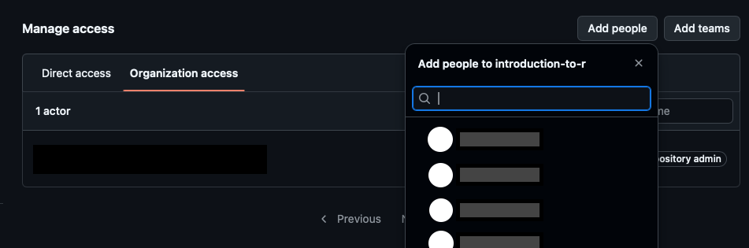{fig-alt="Collaborators and teams page showing how to add add people or teams."}

The options you see depend on whether the repository belongs to you or
to an organisation, and on your permissions in that organisation.
:::

## Publish your website

Your new repository contains a full copy of the template website. From
the files in your repository, GitHub automatically builds your training
website, and publishes it at its own web address.

In this step, you check two settings to make sure your website is
online and can be updated, and you add the link to your website to the main page of your
repository.

### Check that your website is online {.unnumbered}

1. In your repository, click **Settings**, then **Pages** in the menu on
   the left.
{fig-alt="GitHub page showing the link to setup."}
2. At the top of the page, look for **Your site is live at**, followed by
   your website address. It looks like
   `https://ORGANISATION.github.io/REPOSITORY-NAME/`, with your
   organisation (or user name) and repository name filled in.
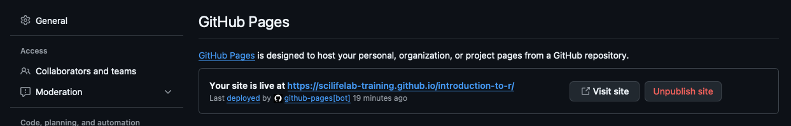{fig-alt="GitHub settings page showing 'your site is live' message."}

::: {.callout-note collapse="true"}
## Don't see "Your site is live at"?

Sometimes GitHub doesn't switch on publishing by itself. You can do it
yourself:

1. On the same page, under **Source**, choose **Deploy from a branch**.
2. Under **Branch**, choose **gh-pages** and **/ (root)**, and click
   **Save**.
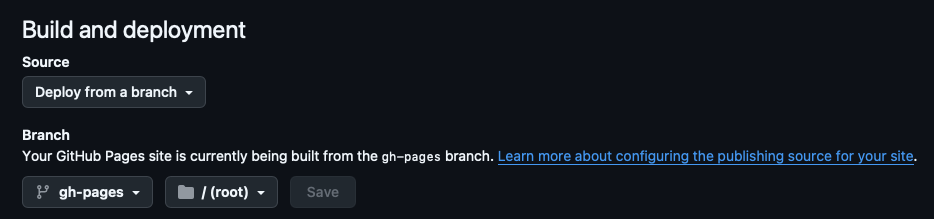{fig-alt="GitHub settings page showing build and deployment box setting."}
3. Wait a minute or two and refresh the page. **Your site is live at**
   now appears at the top.
:::

### Check that your website can be updated {.unnumbered}

Every time you send a change to GitHub, GitHub runs a small automatic process
that rebuilds your website. This process needs permission to update the
website.

1. Click **Settings**, then **Actions → General** in the menu on the left.
2. Scroll down to **Workflow permissions**, and check that
   **Read and write permissions** is selected.
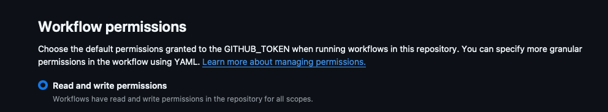{fig-alt="GitHub settings page showing workflow permission settings"}

::: {.callout-note collapse="true"}
## Is "Read repository contents and packages permissions" selected instead?

Select **Read and write permissions** and click **Save**.

If you can't select it because the option is greyed out, your
organisation controls this setting. Ask an administrator of the
organisation to allow it for your repository.
:::

### Add the website link to your repository {#about-link .unnumbered}

Show the website address on your repository's main page, so you can
always find your website quickly:

1. Click the **Code** tab to go back to the repository's main page.
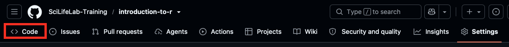{fig-alt="GitHub page showing the link to the code tab."}
2. On the right-hand side, next to **About**, click the gear icon
   <span aria-hidden="true">⚙️</span>.
3. Tick **Use your GitHub Pages website** and click **Save changes**.
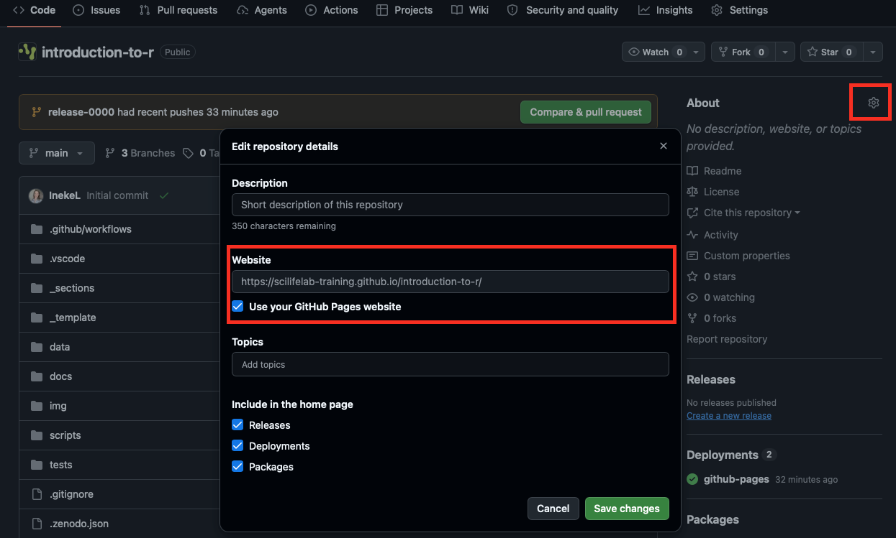{fig-alt="Edit repository details dialog with the GitHub Pages option selected."}


## Open the repository on your computer

So far, your repository only exists on GitHub. To edit it, you make a
copy of it on your computer. This is called **cloning**. Working on a
copy has a big advantage: nothing you change is visible to anyone else
until you decide to send it to GitHub. You can try things out, look at
the result, and undo mistakes, all safely on your own computer.

You work on your copy in **Visual Studio Code**, or **VS Code** for
short: a free program for editing text files. You will use it for most
of your work: to open and edit your files, to see a preview of your
website, and to send your changes to GitHub.

To clone your repository and open it in VS Code:

1. On your repository's main page on GitHub, click the green **Code**
   button, make sure **HTTPS** is selected, and copy the address.  
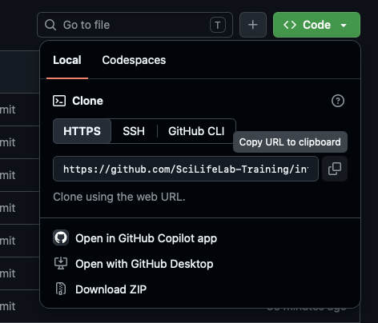{width=40% fig-alt="Screenshot: Code menu with the HTTPS address."}

2. Open Visual Studio Code (VS Code) and click **Clone Git Repository** on the start screen.
   If you don't see it, open **View → Command Palette**, type
   `Git: Clone` and press **Enter**.  
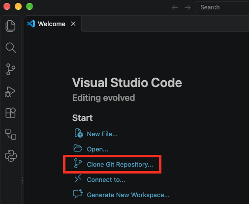{width=50% fig-alt="Screenshot: VScode showing 'clone git repository'."}
3. Paste the HTTPS address you copied and press **Enter**.
4. Choose where to save the repository on your computer, for example a
   folder called `GitHub` inside `Documents`, and click
   **Select as Repository Destination**.
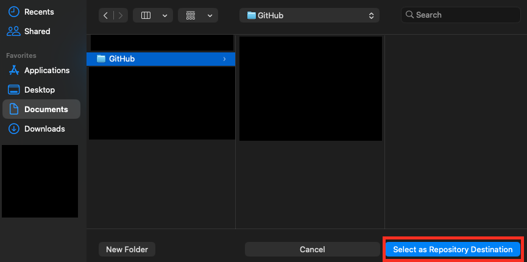{width=80% fig-alt="Screenshot: folders and repository destination button."}
5. When VS Code asks whether to open the repository, click **Open**.

The files and folders of your repository now appear in the **Explorer**
panel on the left side of VS Code. Throughout this guide, you open files
by clicking them there.

If VS Code suggests installing **recommended extensions**, click
**Install**. They help VS Code understand the files used in the template.

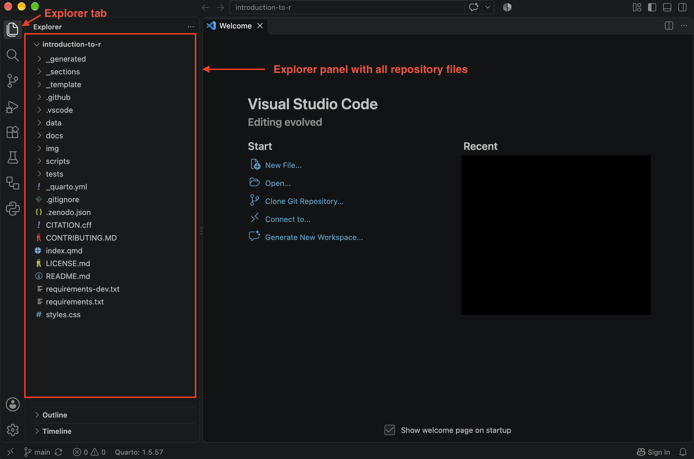{fig-alt="Screenshot: VS Code Explorer with the repository open."}

::: {.callout-tip collapse="true"}
## Prefer the terminal?

```bash
cd ~/Documents/GitHub
git clone https://github.com/ORGANISATION/REPOSITORY-NAME.git
```

Then open the new folder in VS Code with **File → Open Folder...**
:::

## Set up the environment

Your website is built by a few small Python scripts that come with the
template. These scripts need one extra Python package. In this step you
install it in a separate, self-contained **environment** inside your
repository folder, so it doesn't interfere with anything else on your
computer.

You only do this once for each repository. You don't need to understand
the commands: copy each one exactly as shown.

### Open a terminal {#open-a-terminal .unnumbered}

A **terminal** is a window where you type commands. In VS Code, choose
**Terminal → New Terminal**. 

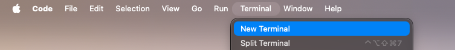{width=70% fig-alt="Screenshot: Terminal, new terminal tab."}

The terminal opens at the bottom of the window, already inside your repository folder.

To run a command from this guide, copy it, paste it into the terminal,
and press **Enter**.

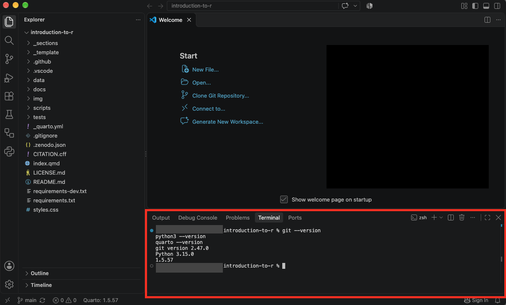{fig-alt="Screenshot: VS Code showing Terminal → New Terminal."}

### Check the software {.unnumbered}

First, check that Git, Python and Quarto were installed correctly. Run
these commands one by one:

::: {.panel-tabset}

## macOS and Linux

```bash
git --version
python3 --version
quarto --version
```

## Windows

```bash
git --version
python --version
quarto --version
```

:::

Each command should print a version number, for example
`Python 3.12.4` (see image above). If one says **command not found**, install that program
again, restart VS Code, and try again.

### Create the environment {.unnumbered}

Run these three commands one by one. The last one can take a minute.

::: {.panel-tabset}

## macOS and Linux

```bash
python3 -m venv .venv
source .venv/bin/activate
python -m pip install -r requirements.txt
```

## Windows

```bash
python -m venv .venv
.venv\Scripts\activate
python -m pip install -r requirements.txt
```

:::

The first command creates the environment, the second switches it on,
and the third installs what the scripts need. When the environment is
switched on, the terminal line starts with `(.venv)`:

```text
(.venv) username@computer introduction-to-r %
```

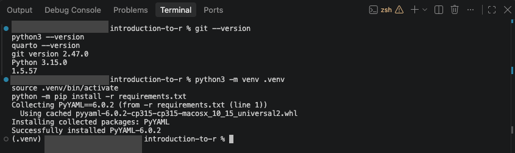{fig-alt="Screenshot: Terminal showing (.venv) at the beginning of the line."}

### Let VS Code switch on the environment {.unnumbered}

The environment has to be switched on each time you open a new terminal.
You can let VS Code do that for you:

1. Press **Cmd+Shift+P** (macOS) or **Ctrl+Shift+P** (Windows and
   Linux).
2. Type `Python: Select Interpreter` and press **Enter**.
3. Choose the option that shows `.venv`.

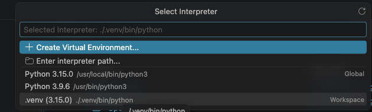{width=70% fig-alt="Screenshot: Select Interpreter list with the .venv option."}

From now on, every new terminal you open in this repository starts with
the environment switched on.

## You're all set! {.unnumbered .unlisted}

Your training has its own repository and website, and your computer is
ready to edit it. You won't need to repeat any of these steps for this
training.

Continue with [Regular workflow](workflow.qmd) to make your first change
and see it appear on your website.