Your landing page now introduces your training as a whole. The next step
is to add the times your training is actually given, each with its own
website and training materials. These are the **training instances**,
which learners reach from the landing page.

In this chapter, you will learn how to:

- [Define a training instance](#what-is-a-training-instance), also
   for self-paced training and training in cohorts.
- [Create your first new training instance](#create-your-first-new-training-instance): make a new branch, and publish its website.
- [Add an instance to the landing page](#add-an-instance-to-the-landing-page): list it in
  the **All training instances** banner, and link it in the hero buttons.
- [Create additional training instances](#create-additional-training-instances),
  the next time your training is given.

::: {.callout-important}
## Adding a training instance always takes two steps!

1. **Create a branch** for the training instance: this creates its
   website.
2. **Add it to the landing page**, in `data/instances.yml` on the
   **main** branch: this makes the website findable.
   
:::

How to switch off template mode and fill in the website of a training instance (its dates, schedule, team and materials) is explained in the next chapters,
[Instance pages - Data files](instance-pages-data-files.qmd) and [Instance pages - Content](instance-pages-content.qmd).

### Before you start {.unnumbered}

In this chapter, you work on two branches: the new **release-** branch,
and **main** for the landing page.

::: {.callout-important}
Commit and push your changes **before** you switch to another branch.
Changes you haven't committed yet move along with you to the other
branch, where you might commit them by mistake.
:::

## What is a training instance? 

A **training instance** is one time your training is given, for example
in May 2027. Each training instance has its own branch in your
repository, and its own website, with its own dates, schedule, team and
materials. The landing page links to them in two places:

- the **current** training instance, in the hero;
   {fig-alt="Screenshot: current instance button in landing page hero."}
- **all** training instances, in the **All training instances** banner.
   {fig-alt="Screenshot: instance banner on landing page."}

Is your training **self-paced**, or given to several **cohorts**? The template works for those too: open the matching box below.

::: {.callout-note collapse="true"}
## Self-paced training: what is a training instance?

In self-paced training, participants start whenever they like, so there
is no "time the training is given". Instead, think of a training instance
as a **version** of your materials:

- **Create a new training instance when you update the materials
  substantially**, for example a new module or a revised structure.
  Small fixes, such as typos, go into the current training instance.
- **Earlier versions stay online.** Participants who started with an
  earlier version can finish with the materials they began with.
:::

::: {.callout-note collapse="true"}
## Training in cohorts: one training instance per cohort?

If your training runs in **cohorts**, groups of participants who follow
the same training at different times, how you set up your training
instances depends on how your training is organised: does each cohort
need its own website, or do the cohorts share one?

**Option 1: one training instance per cohort**

- **When:** each cohort has its own dates, schedule, team or
  announcements.
- **What it represents:** one cohort, with its own website. Each new
  cohort starts from the previous one, as described in
  [Create additional training instances](#create-additional-training-instances).

**Option 2: one training instance for several cohorts**

- **When:** the cohorts follow the same materials and website, and
  only their start dates differ.
- **What it represents:** a version of your materials. List the cohorts
  and their dates on the website, for example in the announcements or
  practicalities (see
  [Instance pages - Data files](instance-pages-data-files.qmd)). Create
  a new training instance only when the materials change substantially.
:::

## Create your first new training instance

### Choose a name {.unnumbered}

Each training instance branch is named **release-** followed by the year
and month in which the training instance is given, written as YYMM (see
[Branches](repository-structure.qmd#branches)). For example:

| Training instance | Branch name |
|---|---|
| May 2027 | `release-2705` |
| November 2027 | `release-2711` |

: {tbl-colwidths="[40,60]"}

The four digits also become the address of its website, for example
`https://ORGANISATION.github.io/REPOSITORY-NAME/2705/`.

For self-paced training and training in cohorts (see
[What is a training instance?](#what-is-a-training-instance)), use these
year and month:

| Your training | Year and month | Example |
|---|---|---|
| Self-paced | When the version is released | `release-2705` for a version released in May 2027 |
| One training instance per cohort | When the cohort starts | `release-2702` for a cohort starting in February 2027, `release-2709` for the next one in September |
| One training instance for several cohorts | When the materials are released | `release-2702` for materials released in February 2027 |

: {tbl-colwidths="[30,30,40]"}

Each branch name must be unique. So with one training instance per
cohort, two cohorts can't start in the same month.

### Switch branch {#switch-branch .unnumbered}

Once you have chosen a name, you can begin creating your new training instance, on a new repository branch. A new branch is always created as a copy of an existing one, so you first have to switch to the branch you want to create a copy of. 

For your **first** training instance: switch to **release-0000**, the example
training instance that comes with the template.

To switch branch in VS Code:

1. Click the branch name in the bottom-left corner of VS Code.

   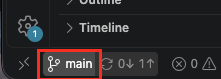{width=30% fig-alt="Screenshot: branch name in VS Code."}

2. In the list that opens at the top, click on the branch you want to switch to, here
   **release-0000**. Branches that are only on GitHub but not VS Code so far start with
   **origin/**: if you choose those they will be added on your computer.

   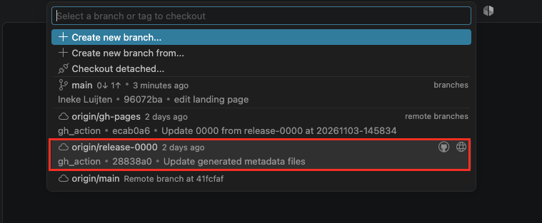{width=80% fig-alt="Screenshot: the branch list in VS Code, with release-0000 selected."}

The files in the Explorer panel change to the files of that branch, and
the bottom-left corner shows its name.

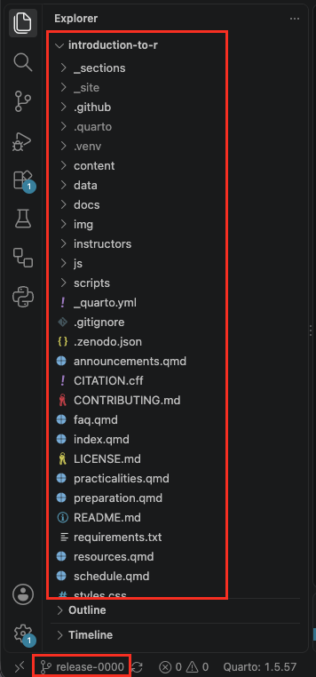{width=45% fig-alt="Screenshot: explorer panel of the release-0000 branch."}
   

### Create the branch {.unnumbered}

1. Check that the bottom-left corner shows the branch you want to copy.
2. Click the branch name (**release-0000**), and choose **Create new branch...** in the list that opens at the top.   
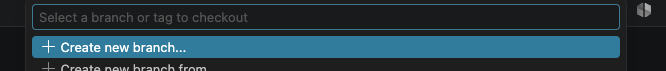{width=80% fig-alt="Screenshot: dropdown menu with create new branch selected."}
3. Type the name of the new branch, for example `release-2706`, and
   press **Enter**.  
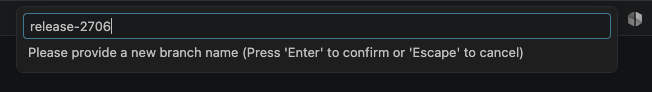{width=80% fig-alt="Screenshot: new branch name typed."} 
4. Open the **Source Control** panel and click **Publish Branch**. This
   puts the new branch on GitHub.  
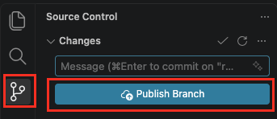{width=45% fig-alt="Screenshot: source control panel with publish branch button."} 

## Add an instance to the landing page

You've now created a branch, and with it the website of your new training
instance. Visitors can't find that website yet: the landing page doesn't
link to it. To add the landing page links, you edit `data/instances.yml` on the **main** branch. The landing page then links to your new training instance in two places:

- the **Take me to the current instance** button in the hero;
- the **All training instances** banner.

To add your first training instance to the landing page:

1. Make sure you've committed any changes you made on your new training instance branch, and switch to the **main** branch, as described in [Switch branch](#switch-branch).
2. Open `data/instances.yml`. It lists the training instances the
   landing page links to: one entry per training instance, from
   `- slug:` to `sort_key:`. The comments at the top of the file explain
   each field.  
   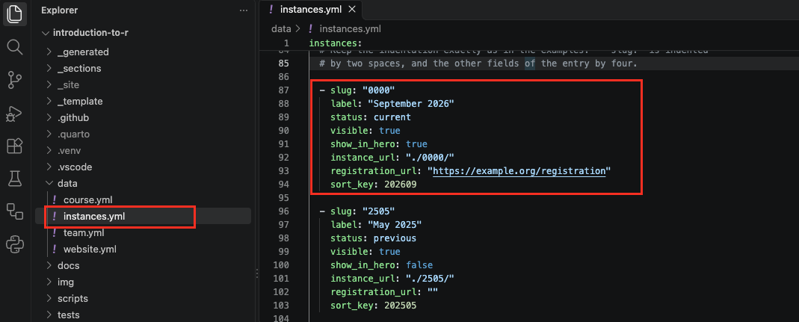{width=80% fig-alt="Screenshot: all instances listed in instances.yml on the main branch."}
   
3. The list contains example training instances. Change the first one,
   with `slug: "0000"`, into your own training instance: change its
   `slug`, `label`, `instance_url` and `sort_key`. If registration is
   open, add the link to the registration page or form under
   `registration_url`. Without registration, keep `registration_url: ""` and the registration button will disappear. 

   For example, for a June 2027 training instance with no registration:

   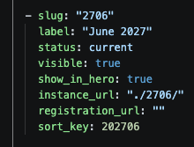{width=25% fig-alt="Screenshot: one instance filled out for a training instance in june 2027."}
   

4. Delete the other examples, **2505** and **2411**: each whole entry,
   from `- slug:` to `sort_key:`. They are only there to show how the
   list works in the template, and link to websites that don't exist in your repository.
5. Save the file, and check the preview: the hero button and the
   **All training instances** banner now show your training instance.

   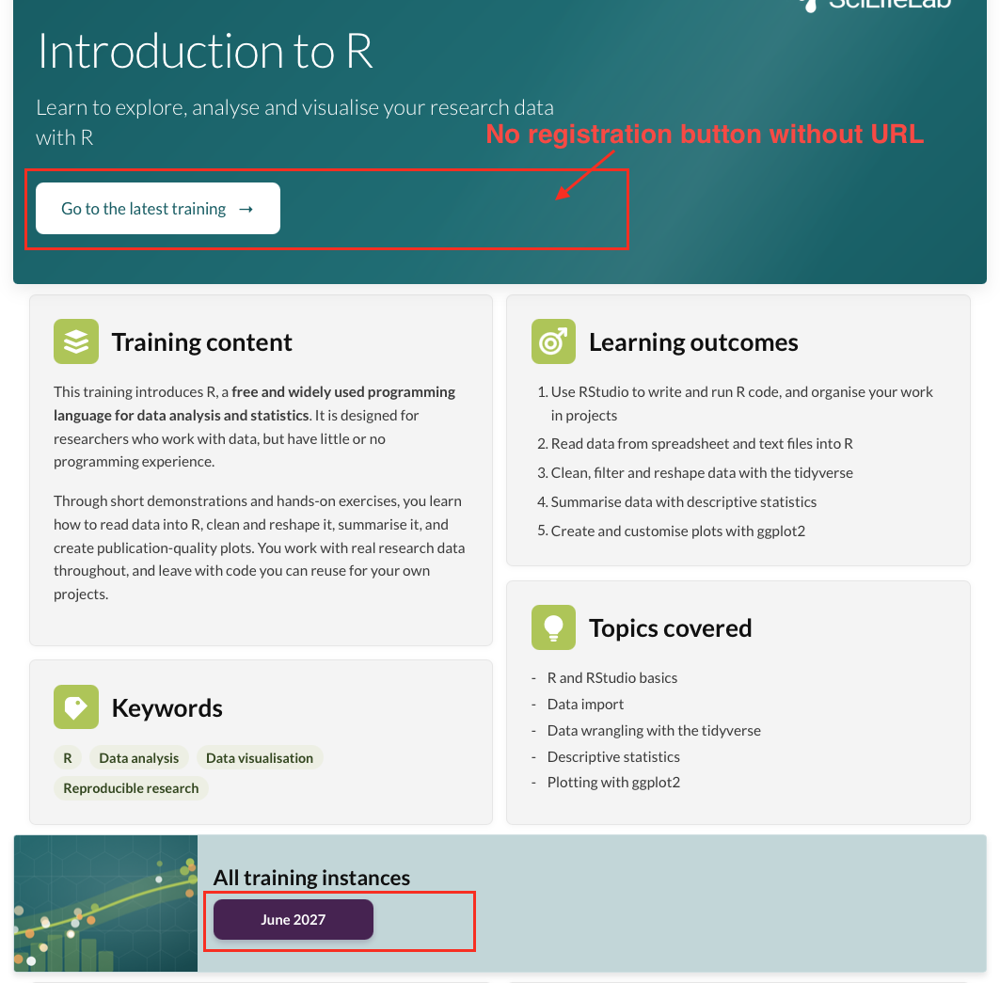{width=75% fig-alt="Screenshot: landing page showing the june 2027 training instance."}

   Commit and push your changes.

If you break one of the rules described in the file, the preview shows
an error that explains what to fix.

::: {.callout-tip collapse="true"}
## Optional: delete the release-0000 branch

Once your own training instance exists, you no longer need the example **release-0000** branch. You can keep it, to look up how something was set
up in the template, or delete it:

1. Delete the branch: on your repository's main page on GitHub, click
   **Branches**.
   
   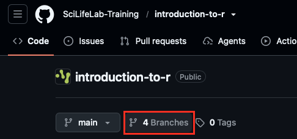{width=40% fig-alt="Screenshot: branches link on github in web browser."}
   
   Click the bin icon next to **release-0000**.

   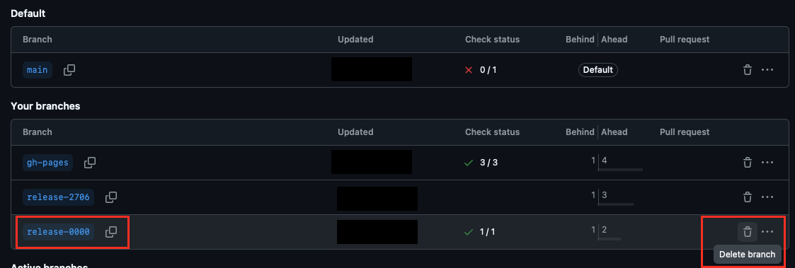{width=75% fig-alt="Screenshot: delete branches on github in web browser."}
   
2. Delete its website: on the **gh-pages** branch on GitHub, open the
   `0000` folder, click **⋯** at the top right, and choose
   **Delete directory**.

   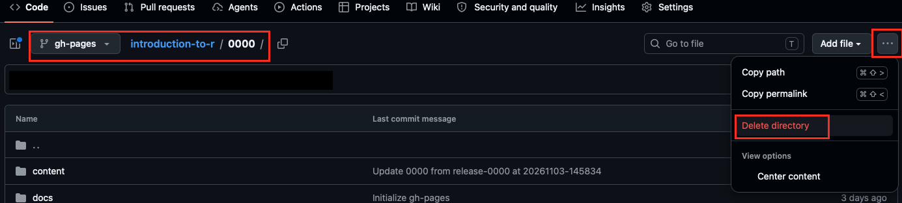{width=85% fig-alt="Screenshot: delete directory on gh-pages branch on github in web browser."}
   
**Only delete it when your own first training instance is ready.** Your
later training instances start from your own previous one, so you don't
need **release-0000** for those. But once deleted, it's gone!
:::

## Create additional training instances

The next time your training is given, start from your previous training
instance rather than from **release-0000**. That way, everything you
prepared last time comes along: your materials, instructor notes, team
and settings. The previous training instance keeps its own branch and
website, so participants can always go back to the materials as they
were.

1. Switch to your previous training instance branch, for example
   **release-2706**, and create a new branch from it, for example
   `release-2711`, as described in
   [Create your first new training instance](#create-your-first-new-training-instance).
2. Update the information of the new training instance, such as its
   dates, schedule and team: see [Instance pages - Data files](instance-pages-data-files.qmd).
3. Switch to the **main** branch, and open `data/instances.yml`.
4. Add the new training instance: copy the entry of the current one,
   paste it at the top of the list, and change `slug`, `label`,
   `instance_url` and `sort_key`. Add a registration URL if registration is open. 
5. Make the new training instance the current one. In the entry of the
   previous training instance, change `status: current` to
   `status: previous`, and `show_in_hero: true` to `show_in_hero: false`.

   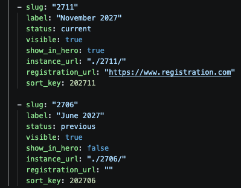{width=45% fig-alt="Screenshot: data/instances.yml on main branch with a new november 2027 training instance added."}
   
6. Save the file, check the preview, and commit and push.

::: {.callout-note}
The training instance with `status: current` is the one the 'take me to the current instance' hero button leads to. Every other instance in the list needs to have `status: previous`. For all instances that have `status: previous`, their websites automatically show a banner saying: *This is an older instance of this training*, with a link to the current one. 
:::

::: {.callout-important}
If your previous training instance was published on Zenodo, empty
`version_doi` and `release_date` under `reuse` in `data/course.yml` of
the new branch: they belong to the previous training instance. See
[FAIRification](fairification.qmd).
:::

## Cheat sheet

| To... | Where | What to do |
|---|---|---|
| Switch branch | VS Code, bottom-left corner | Click the branch name and choose a branch |
| Create a training instance | VS Code, bottom-left corner | Switch to the branch to copy (**release-0000** the first time), click the branch name, choose **Create new branch...** and type `release-YYMM` |
| Publish the new branch on GitHub | VS Code, Source Control panel | Click **Publish Branch** |
| Add your first instance to the landing page | **main** branch, `data/instances.yml` | Change the `"0000"` entry to your training instance, and delete the example instances |
| Delete the release-0000 branch (optional) | GitHub | Delete the **release-0000** branch on the branches page, and the `0000` folder on the **gh-pages** branch |
| Create another training instance | VS Code, bottom-left corner | Create a new branch from your previous training instance, not from **release-0000** |
| Add another instance to the landing page | **main** branch, `data/instances.yml` | Copy the entry of the current training instance to the top, and change `slug`, `label`, `instance_url` and `sort_key` |
| Make a new instance the current one | **main** branch, `data/instances.yml` | For the previous instance, set `status: previous` and `show_in_hero: false` |

: {tbl-colwidths="[28,24,48]"}
