This chapter shows the steps you repeat **every time** you work on your
training website: open your training, preview it, make your changes, and
publish them.

The steps are always the same, whether you change a date, add a team member or write a new page of materials.
The [cheat sheet](#cheat-sheet) at the end of this chapter lists all of them in one table.

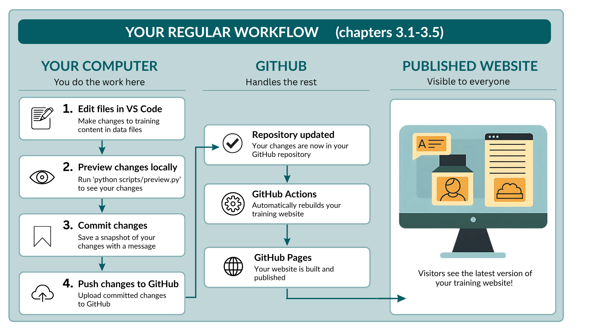{fig-alt="Workflow showing the regular editing and publishing steps."}


::: {.callout-note}
This chapter assumes you have done the one-time setup in
[Set up your training](setup.qmd).
:::


## Open your training

Each time you start working, open your repository in VS Code and make
sure you have the latest version.

1. Open VS Code. It usually reopens the repository you worked on last.
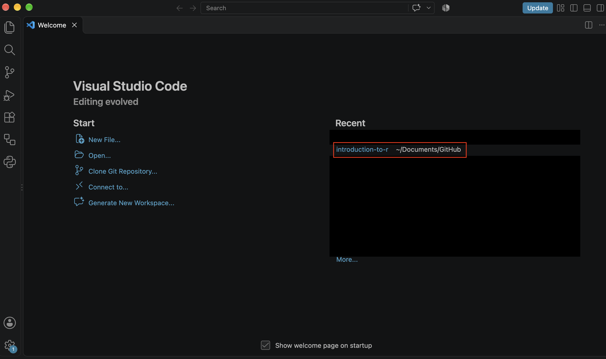{width=80% fig-alt="Screenshot: Opening the repository from recent."}  
   If not, choose **File → Open Recent**, or **File → Open Folder...**
   and select your repository folder.   
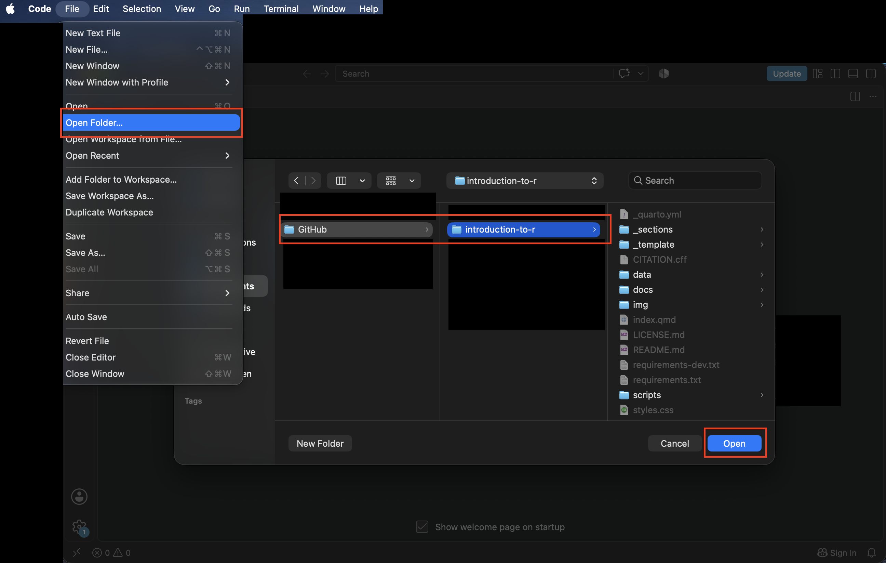{width=80% fig-alt="Screenshot: Opening the repository from file."}


2. **Get the latest version.** If you work together with others, they
   may have uploaded changes since you last worked. In the bottom-left
   corner of VS Code, click the circular arrows next to the branch name
   (**Synchronize Changes**). This downloads their changes to your
   computer.   
   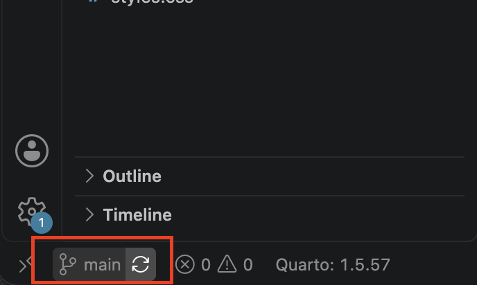{width=40% fig-alt="Screenshot: VS Code status bar with the branch name and the Synchronize Changes arrows."}

### Which part of your website are you working on? {#switch-branch .unnumbered}

The bottom-left corner of VS Code also shows the **branch** you are
working on. Your repository keeps each part of your training website in its own
branch (see [Repository structure](repository-structure.qmd#branches)):

- **main**: the training landing page.
- **release-** followed by four digits, for example **release-2605**: one
  training instance in May 2026. In your template copy, it will say **release-0000**

   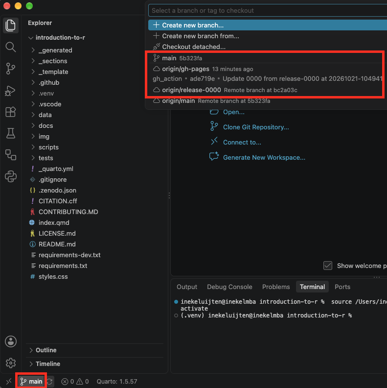{width=60% fig-alt="Screenshot: VS Code status bar showing the branch name main."}

Before you start editing, check that you are on the branch you want to
change. For your first change below, stay on **main**.

## Preview your website

A **preview** shows your website in your web browser while you work on
it, before anything is published. The preview runs on your own computer,
so only you can see it. This lets you check every change before your
collaborators or participants see it.

To start the preview, open a terminal (**Terminal → New Terminal**, see [Open a terminal](setup.qmd#open-a-terminal)) and
run:

```bash
python scripts/preview.py
```

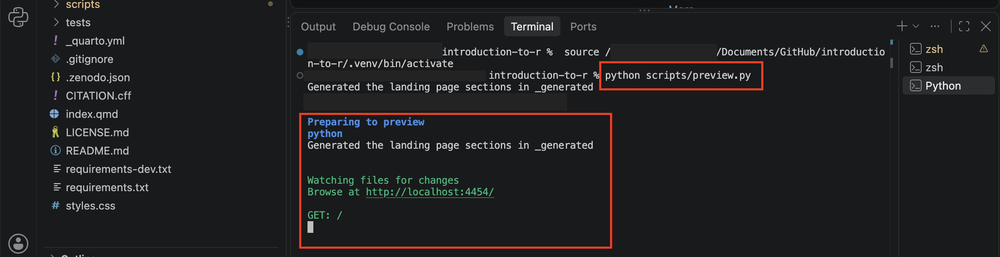{fig-alt="Terminal displaying command 'quarto preview'"}

Quarto now builds your website. After a few seconds, it opens in your
web browser. 

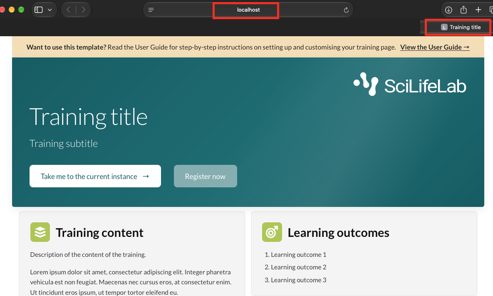{width=75% fig-alt="Landing page displayed locally in a web browser using Quarto preview."}

If it doesn't open by itself, copy the address shown in the
terminal, for example `http://localhost:4268/`, and paste it into your
browser.


Keep the preview running while you work. Each time you save a file (Cmd+S (macOS) or Ctrl+S (Windows and Linux)), the preview updates by itself.

- To **run other commands** while the preview is running, open a second
  terminal with **Terminal → New Terminal**. The terminal running the
  preview is busy.
- To **stop the preview** when you are done, click in the terminal
  where it runs and press **Ctrl+C**.

::: {.callout-tip collapse="true"}
## Another way to start the preview: the Preview button

When a page file (ending in `.qmd`) is open in VS Code, you can also
click the **Preview** button in the top-right corner of the editor. 

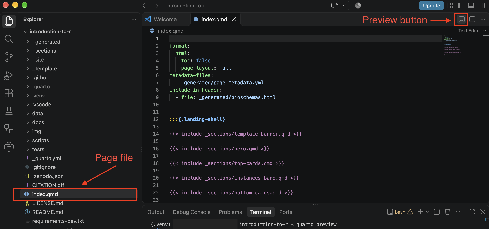{width=85% fig-alt="Screenshot: VS Code showing the Preview button."}

The website then opens inside VS Code. To see it in your browser instead, click **Open in Browser**.

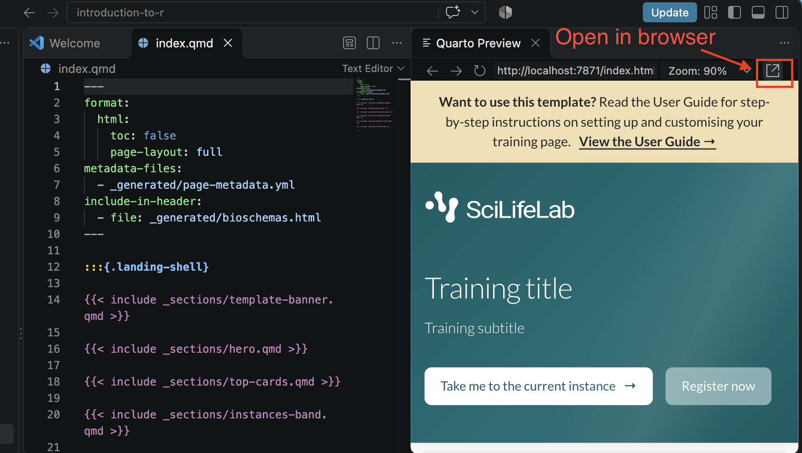{width=75% fig-alt="Screenshot: VS Code showing the open in browser button."}

:::

## Make a change

Almost everything on your website comes from the files in the `data`
folder: the title, dates, team, schedule, and so on. You change your
website by changing these files, without touching any code.

How these files are organised is explained in
[Repository structure](repository-structure.qmd). For now, we focus on
making one change and publishing it, so you can practice the whole process
from start to finish.

As a first change, try changing the title of your training:

1. In the Explorer panel, open the `data` folder and click `course.yml`.

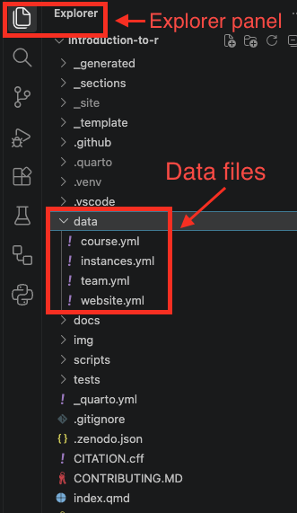{width=30% fig-alt="Screenshot: VS Code showing the explorer panel with data folder"}

2. Scroll down a bit and find the line:

   ```yaml
   title: "Training title"
   ```

3. Change the text between the quotation marks to your training's title, for example:

   ```yaml
   title: "Introduction to R"
   ```

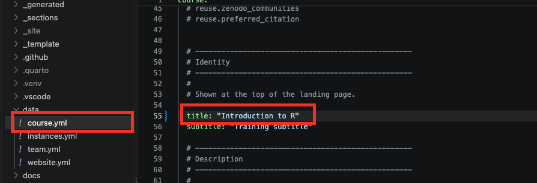{width=80% fig-alt="Screenshot: VS Code showing course.yml and training title change."}

4. Save the file with **Cmd+S** (macOS) or **Ctrl+S** (Windows and
   Linux).

The new title now appears at the top of the website preview in your browser.

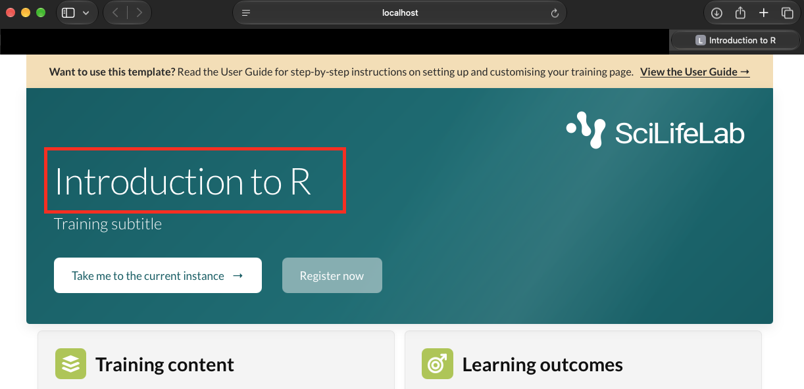{width=80% fig-alt="Screenshot: Updated title in the preview."}

::: {.callout-important}
**The data files are very sensitive to layout!** Keep the quotation marks, and
keep the indentation at the start of each line exactly as it is. If the
preview shows an error after you save, check the file layout first. The lines
starting with `#` are explanations: they don't appear on the website.
:::

## Commit and push your changes

Your change is now saved on your computer, but nobody else can see it
yet. Publishing it takes two steps, both in VS Code's **Source Control**
panel:

- **Commit**: save a version of your changes, with a short description of
  what you changed. Each commit is kept, so you can always see what
  changed and when.
- **Push**: upload your commits to GitHub. GitHub then updates your
  website automatically.

1. Click the **Source Control** icon on the left side of VS Code. Your
   changed files are listed under **Changes**.

   You changed only `course.yml`, but you probably see more files, for
   example files in the `_generated` folder. That's expected: the
   template updates these files automatically from your data files,
   while the preview runs. Depending on what you change, you may also
   see `README.md`, `CITATION.cff` or `.zenodo.json`. Always commit
   **all** changed files together.   
  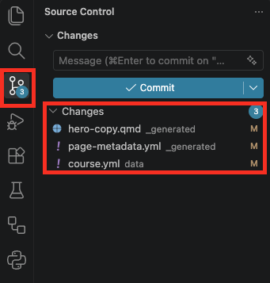{width=35% fig-alt="Screenshot: Source Control panel showing the changed file."}

2. Hover over the word **Changes** and click the **+** next to it
   (**Stage All Changes**). This tells VS Code to include all changed
   files in your commit. They move to **Staged Changes**.  
  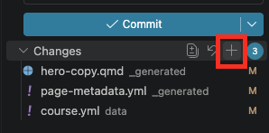{width=35% fig-alt="Screenshot: Source Control panel showing staged changes."}

3. In the **Message** box at the top, describe your change, for example
   `Change the training title`.  
  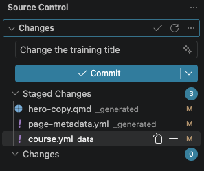{width=35% fig-alt="Screenshot: Source Control panel showing staged changes with commit message."}

4. Click **Commit**.

5. Click **Sync Changes** to push your commit to GitHub.   
  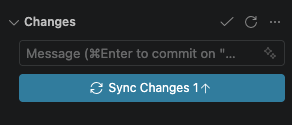{width=35% fig-alt="Screenshot: Sync Changes button."}

::: {.callout-note}
The first time you push, VS Code may ask you to sign in to GitHub. Follow
the instructions in your browser, then return to VS Code.
:::

::: {.callout-important}
If you want to make changes on several branches, commit and push your changes on one branch **before** you switch to another branch. Changes you haven't committed yet move along with you to the other
branch, where you might commit them by mistake.
:::

::: {.callout-tip collapse="true"}
## Changed something by mistake?

**Before** you commit, you can undo all changes to a file: in the Source
Control panel, hover over the file and click the curved arrow
(**Discard Changes**). The file goes back to how it was at your last
commit.  
 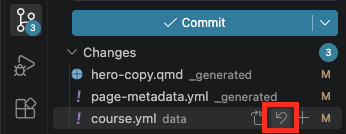{width=35% fig-alt="Screenshot: Discard Changes button."}

You only need to do this for the files you changed yourself, such as
`data/course.yml`. The files the template updates automatically, for
example in the `_generated` folder, go back by themselves: as soon as
you discard your own change, the preview rebuilds them, and they
disappear from the list after a few seconds.

This only works while the preview is running. If they are still listed,
start the preview (`python scripts/preview.py`) and wait a few seconds.
:::

## Check the published website

After you push your local changes to GitHub to be published, GitHub rebuilds your website by itself.
This usually takes one or two minutes. You can follow it on GitHub:

1. Open your repository on GitHub and click the **Actions** tab.  
 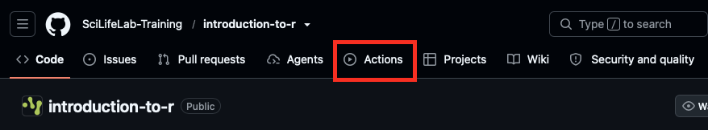{width=75% fig-alt="Screenshot: Github actions tab."}

2. Wait until both of these show a green checkmark:
   - **deploy-landing** (or **deploy-instance**, when you changed a
     training instance): builds your website;
   - **pages build and deployment**: publishes it.  

   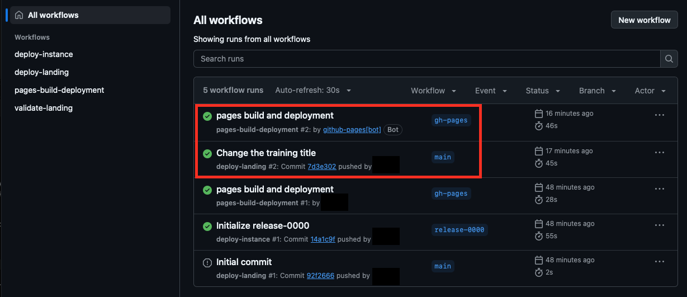{width=75% fig-alt="Screenshot: Actions tab with deploy-landing and pages build and deployment both green."}
   
   A yellow dot means it is still running.

3. Open your website with the link under **About** on your repository's
   main page, see [About link](setup.qmd#about-link). 

::: {.callout-tip}
Still seeing the old version? Wait a minute and refresh the page.
Browsers sometimes show an older copy for a short while.

A red cross in the Actions tab means something went wrong. Click it to
see the error message, or see the [cheat sheet](#cheat-sheet) below.
:::

## Cheat sheet


Every time you work on your training, follow these steps in this order.

| To... | Where | What to do | What you should see |
|---|---|---|---|
| **1. Open your training repository** | VS Code | Open VS Code. If your repository isn't open, choose **File → Open Recent** | Your files in the Explorer panel on the left |
| **2. Get the latest version** | VS Code, bottom-left corner | Click the circular 'sync changes' arrows next to the branch name | Your collaborators' changes appear in your files |
| **3. Check the branch** | VS Code, bottom-left corner | Read the branch name: **main** for the landing page, **release-YYMM** for a training instance | The branch you want to change |
| **4. Start the preview** | Terminal (**Terminal → New Terminal**) | Type `python scripts/preview.py` and press **Enter** | Your website opens in your browser |
| **5. Make your changes** | Explorer panel | Open a file, usually in the `data` folder. Change only the text after the colon, and save with **Cmd+S** or **Ctrl+S** | The preview updates by itself after a few seconds |
| **6. Stage your changes** | Source Control panel (left side) | Hover over **Changes** and click **+** to stage all changed files, including files you didn't change yourself | The files move to **Staged Changes** |
| **7. Commit** | Source Control panel | Type a short description in **Message** and click **Commit** | The **Sync Changes** button appears |
| **8. Push** | Source Control panel | Click **Sync Changes** | No more changes listed |
| **9. Check** | GitHub, **Actions** tab | Wait for two green checkmarks | Your change on the published website |
| **10. Stop the preview** | Terminal running the preview | Press **Ctrl+C** | The terminal accepts commands again |

## If something goes wrong

| What you see | What it means | What to do |
|---|---|---|
| The terminal line doesn't start with `(.venv)` | The environment is switched off | Open a new terminal. If that doesn't help, run `source .venv/bin/activate` (Windows: `.venv\Scripts\activate`) |
| command not found: python | The environment is switched off | Same as above |
| The preview shows an error after you saved a data file | The file's layout is broken | Check the quotation marks and the spaces at the start of the lines you changed |
| Sync Changes asks you to sign in | VS Code isn't connected to GitHub yet | Follow the sign-in steps in your browser |
| A red cross in the **Actions** tab | Building the website failed | Click it to read the error message; it usually names the data file and the field to fix |
| The website still shows the old version | Publishing isn't finished, or your browser shows an old copy | Wait a minute, then refresh the page |
| You changed something by mistake (not committed yet) | — | Source Control panel: hover over the file and click the curved arrow (**Discard Changes**) |

